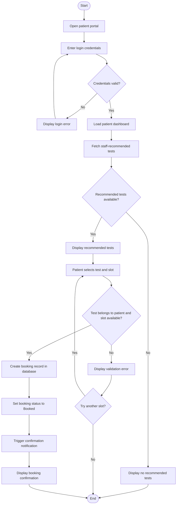

# Session 7 — UML Activity Diagram

## Workflow
This activity diagram describes the diagnostic test booking workflow from sign-in through booking confirmation or recovery from an invalid/unavailable slot.

## Activity notes
- Invalid credentials return the patient to the login step.
- Only tests recommended for the authenticated patient may be booked.
- An unavailable slot does not create a booking; the patient may retry.
- The booking is saved before the confirmation is sent.
- Notification delivery depends on the configured SNS/SES integration.
