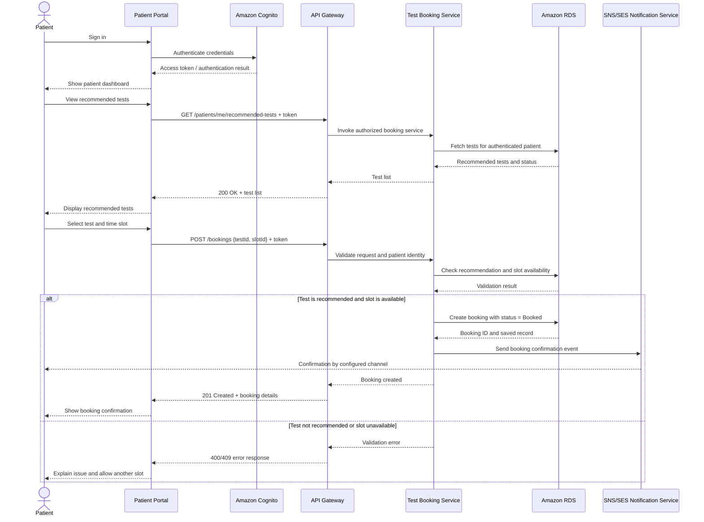

# Session 7 — UML Sequence Diagram

## Scenario
A patient signs in, views diagnostic tests recommended by hospital staff, selects an available slot, and books the test. The system validates the request, saves the booking, and sends a confirmation.

## Participants
- Patient
- Patient Portal
- Amazon Cognito
- API Gateway
- Test Booking Service (AWS Lambda)
- Amazon RDS
- Notification Service (SNS/SES)

## Sequence diagram

## Main message flow
1. The patient authenticates and receives a token.
2. The portal requests only the current patient's recommended tests.
3. The API authorizer validates the token before the booking service is invoked.
4. The booking service validates recommendation ownership and slot availability.
5. A valid booking is persisted before a confirmation is sent.
6. If validation fails, no booking is created and the patient can choose another slot.

## Design note
The diagram models the architecture described in the project README. Actual endpoint names and response codes should be aligned with the implementation when the backend API is finalized.
