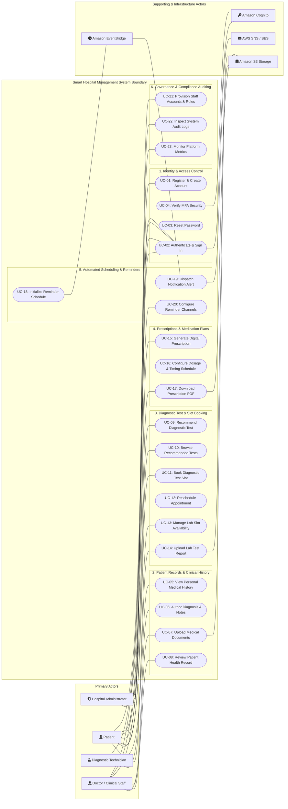
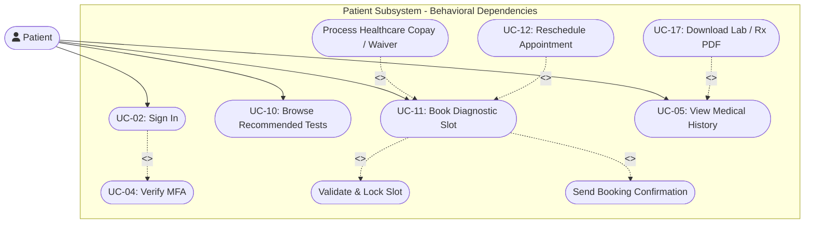
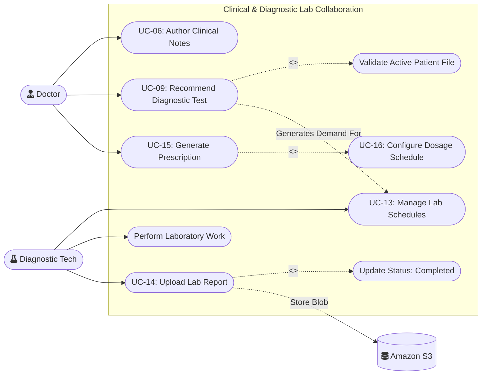

# EXPERIMENT 5

**Course Title**: Software Design Principles (SDP)  
**Course Code / Section**: IT-B (Academic Year 2026-27)  
**Selected Project**: Smart Hospital Management System (SHMS)  
**Document**: UML Use Case Modeling & Requirement Analysis  
**Tools Employed**: StarUML / Draw.io / Mermaid UML Modeling Engine  
**Deliverable**: System Use Case Diagrams and Comprehensive Use Case Narratives  
**Industry Mapping**: Requirement Modeling & Object-Oriented Systems Analysis  
**Team Details**: 4 Collaborators (Team Project)  
**Contributor**: Gungun Jain (Roll No: `202401100600082`, `gungunjn08@gmail.com`)  

---

## 1. Aim
To identify system actors, formulate functional use cases, engineer comprehensive UML Use Case Diagrams depicting system boundaries and behavioral dependencies (`<<include>>`, `<<extend>>`, and Generalization), and construct industry-standard Use Case Narratives for the **Smart Hospital Management System (SHMS)** using StarUML and Draw.io.

---

## 2. Objectives
1. **Actor Identification & Role Categorization**: Identify all human, internal, and external secondary actors interacting with the Smart Hospital Management System and define their organizational boundaries and access authorities.
2. **Use Case Identification & System Boundary Formulation**: Deconstruct elicited stakeholder requirements (from Experiment 3 and Experiment 4 SRS) into discrete, verifiable functional use cases within the system boundary.
3. **Advanced UML Relationship Modeling**: Model behavioral dependencies using standardized UML stereotypes:
   - `<<include>>`: Mandatory subroutines (e.g., identity verification before medical updates).
   - `<<extend>>`: Optional/conditional business extensions (e.g., handling rescheduling or emergency priority tagging).
   - **Generalization**: Hierarchy between generic system users and specialized clinical/administrative actors.
4. **Use Case Diagram Construction**: Develop complete, unambiguous UML diagrams using StarUML and Draw.io visual modeling standards.
5. **Detailed Use Case Specifications (Narratives)**: Document formal Cockburn-style use case descriptions covering preconditions, postconditions, primary/alternative flows, exception paths, and non-functional requirements.
6. **Traceability Alignment**: Establish bi-directional traceability between SRS Functional Requirements (`REQ-1.1` through `REQ-6.4`) and identified Use Cases.

---

## 3. Theoretical Framework & Background

### 3.1 Principles of UML Use Case Modeling
Use Case Modeling is a standardized Object-Oriented Analysis (OOA) technique defined under the Unified Modeling Language (UML 2.5) standard overseen by the Object Management Group (OMG). It captures the dynamic behavior of a software system by describing *what* the system does from an external actor's perspective without specifying *how* internal algorithms or database schemas are implemented.

### 3.2 Key Components of a UML Use Case Model
A UML Use Case Model consists of four primary structural elements:
1. **System Boundary**: A bounding rectangle enclosing all use cases, defining the scope and perimeter of the software solution. External actors reside strictly outside this boundary.
2. **Actors**: Entities external to the software boundary that interact with the system to achieve a specific business goal.
   - **Primary Actors**: Human users or systems who initiate an interaction to achieve a direct goal (e.g., Patient, Doctor, Administrator).
   - **Secondary / Supporting Actors**: External services, cloud infrastructure, or third-party APIs that assist the system in executing use cases (e.g., Amazon Cognito, Amazon EventBridge, AWS SNS/SES, Amazon S3).
3. **Use Cases**: Ellipses within the system boundary representing coherent units of end-to-end functionality that yield an observable result of value to an actor.
4. **Relationships**:
   - **Association**: A solid line indicating communication between an actor and a use case.
   - **`<<include>>` Dependency**: A directed dashed arrow from a base use case to an included use case. Denotes mandatory inclusion; the base use case cannot complete without executing the included use case.
   - **`<<extend>>` Dependency**: A directed dashed arrow from an extending use case to a base use case. Indicates optional or conditional behavior triggered at explicit extension points.
   - **Generalization**: A solid line with a hollow triangular arrowhead denoting inheritance of permissions, attributes, and relationships (e.g., Doctor inherits from System User).

### 3.3 Industry Mapping: Requirement Modeling in Modern SDLC
In professional enterprise software engineering:
- **Agile Epics & User Stories Decomposition**: Use cases serve as the foundational architecture for Epic decomposition, defining the testable boundaries of user stories.
- **Microservice Boundary Identification**: Clusters of tightly coupled use cases define the bounded contexts in Domain-Driven Design (DDD), directly determining microservice splits (e.g., Patient Records Service vs. Test Booking Service vs. Reminder Service).
- **Quality Assurance & Verification**: QA test architects transform use case main success scenarios into positive regression test suites, while alternative and exception paths form negative integration test matrices.
- **Contract Definition & Compliance**: In regulated healthcare technology (HIPAA, HL7, FHIR, GDPR), use case narratives serve as legal and operational audit artifacts verifying that access controls and data lifecycles adhere to privacy regulations.

---

## 4. Actor Identification and Categorization

The Smart Hospital Management System interfaces with both human organizational roles and external cloud infrastructure actors.

| Actor Name | Classification | Description & System Responsibilities | Associated System Boundaries |
| :--- | :--- | :--- | :--- |
| **System User** | Abstract Human Actor | Base user entity containing common security attributes (email, credentials, session tokens). Generalizes into concrete roles. | Identity & Access Module |
| **Patient** | Concrete Primary Actor | Registered healthcare recipient. Views personal electronic health records, explores recommended diagnostic investigations, books appointment slots, and receives automated medicine/test reminders. | Patient Portal (Web / Mobile) |
| **Doctor / Clinical Staff** | Concrete Primary Actor | Licensed physician or clinical provider. Examines patient histories, authors diagnoses and clinical notes, recommends laboratory tests, and prescribes digital medication schedules. | Clinical Staff Portal |
| **Diagnostic Lab Technician** | Concrete Primary Actor | Laboratory personnel responsible for managing available investigation slots, performing ordered tests, and uploading authenticated diagnostic test reports (PDF/DICOM/scans). | Diagnostic Portal |
| **Hospital Administrator** | Concrete Primary Actor | Operational governance personnel responsible for staff onboarding, role provisioning, system configuration, compliance monitoring, and access audit log reviews. | Admin Dashboard |
| **Amazon Cognito** | External Secondary Actor | AWS Managed Identity Provider that handles secure user pool authentication, OAuth2 / JWT token generation, password hashing, and group-based authorization scopes. | AWS Cloud Infrastructure |
| **Amazon EventBridge** | External Secondary Actor | Serverless cron and event bus scheduler that evaluates scheduled reminder triggers and dispatches payload events to compute handlers. | Automated Scheduling Service |
| **AWS SNS / SES Service** | External Supporting Actor | Multi-channel communication service delivering automated Short Message Service (SMS) text messages and Simple Email Service (SES) alerts to patients. | Communication Infrastructure |
| **Amazon S3 Object Store** | External Supporting Actor | High-durability cloud object storage holding patient diagnostic lab reports, uploaded medical scans, and digitally signed prescription documents. | Data Persistence Layer |

---

## 5. Use Case Identification & Traceability Matrix

The system functionality is partitioned into six core functional subsystems mapped directly from the Software Requirements Specification (Experiment 4).

| Subsystem | Use Case ID | Use Case Name | Primary Actor | Associated SRS Requirement | Dependency / Relationship |
| :--- | :--- | :--- | :--- | :--- | :--- |
| **1. Identity & Access** | **UC-01** | Register & Create Account | Patient | `REQ-1.1` | Base Use Case |
| | **UC-02** | Authenticate & Sign In | System User | `REQ-1.2`, `REQ-1.3` | Includes `Verify Credentials` |
| | **UC-03** | Reset Forgotten Password | System User | `REQ-1.2` | Extends `UC-02` |
| | **UC-04** | Verify Multi-Factor Auth (MFA) | System User | `REQ-1.4`, `REQ-5.3` | `<<include>>` in `UC-02` for Staff/Admin |
| **2. EHR & Clinical History** | **UC-05** | View Personal Medical History | Patient | `REQ-2.3` | Requires valid session token |
| | **UC-06** | Author Diagnosis & Clinical Notes | Doctor | `REQ-2.1`, `REQ-2.2` | Base Use Case |
| | **UC-07** | Upload Past Medical Documents | Doctor / Patient | `REQ-2.4` | Connects to Amazon S3 |
| | **UC-08** | Review Comprehensive Patient File | Doctor | `REQ-2.2` | Includes `Verify Access Scope` |
| **3. Diagnostic Test Management**| **UC-09** | Recommend Diagnostic Test | Doctor | `REQ-3.1` | Base Use Case |
| | **UC-10** | Browse Recommended Tests | Patient | `REQ-3.2` | Base Use Case |
| | **UC-11** | Book Diagnostic Test Slot | Patient | `REQ-3.2`, `REQ-3.3` | Includes `Verify Slot Availability` |
| | **UC-12** | Reschedule Test Appointment | Patient | `REQ-3.3` | `<<extend>>` `UC-11` (Conditional) |
| | **UC-13** | Manage Lab Slot Availability | Diagnostic Technician | `REQ-3.4` | Base Use Case |
| | **UC-14** | Upload Lab Investigation Report | Diagnostic Technician | `REQ-3.5` | Includes `Update Booking Status` |
| **4. Digital Prescriptions** | **UC-15** | Generate Digital Prescription | Doctor | `REQ-4.1`, `REQ-4.2` | Base Use Case |
| | **UC-16** | Configure Dosage & Schedule | Doctor | `REQ-4.2` | `<<include>>` in `UC-15` |
| | **UC-17** | Download Prescription PDF | Patient | `REQ-4.3` | Extends `UC-05` |
| **5. Automated Reminders** | **UC-18** | Initialize Medication Reminder Schedule | System / Doctor | `REQ-5.1` | Triggered by `UC-15` |
| | **UC-19** | Dispatch Scheduled Reminder Notification | Amazon EventBridge / SNS | `REQ-5.2` | Secondary actor initiated |
| | **UC-20** | Configure Notification Channels | Patient | `REQ-5.3` | Base Use Case |
| **6. Administration & Auditing** | **UC-21** | Provision Staff Accounts & Roles | Hospital Administrator | `REQ-6.1`, `REQ-1.3` | Base Use Case |
| | **UC-22** | Inspect System Audit Logs | Hospital Administrator | `REQ-6.2`, `REQ-5.4` | Base Use Case |
| | **UC-23** | Monitor System Health & Metrics | Hospital Administrator | `REQ-6.3` | Base Use Case |

---

## 6. Comprehensive UML Use Case Diagrams

### 6.1 Complete System Boundary Use Case Diagram
The following architectural diagram illustrates the complete system boundary, all five human and cloud actors, and their interactions with the twenty-three functional use cases.

---

### 6.2 Patient Portal Detailed Behavioral Diagram (Depicting `<<include>>` and `<<extend>>`)
This diagram highlights advanced UML stereotypes within the patient self-service workflow, demonstrating slot reservation, document viewing, and notification dispatching dependencies.

---

### 6.3 Clinical Provider & Diagnostic Workflow Diagram
This diagram depicts clinical interactions where physician orders directly trigger downstream diagnostic slot availability and laboratory reporting workflows.

---

## 7. Industry-Standard Use Case Description Templates (Narratives)

To comply with Cockburn's high-ceremony use case documentation standard, eight core use cases representing critical clinical, patient, administrative, and automation workflows are specified in rigorous detail below.

---

### 7.1 Use Case Narrative: UC-01 — Authenticate User and Enforce Role-Based Access Control

| Attribute | Specification Details |
| :--- | :--- |
| **Use Case ID** | **UC-01** (Corresponds to System Feature 4.1 in SRS) |
| **Use Case Name** | Authenticate User and Enforce Role-Based Access Control |
| **Iteration / Version** | Version 1.0 (Final Approved) |
| **Primary Actor** | System User (Generalizes Patient, Doctor, Diagnostic Technician, Hospital Administrator) |
| **Secondary Actors** | Amazon Cognito User Pools, API Gateway Cognito Authorizer, CloudWatch Audit Log |
| **Stakeholder Interests** | - **Patients**: Expect zero unauthorized access to confidential health records. - **Clinical Staff**: Require quick, uninterrupted authentication without session dropouts. - **Hospital Admin**: Requires strict verification and auditing of all authenticated sessions. |
| **Preconditions** | 1. User account has been successfully provisioned with active status. 2. User possesses registered credentials (email and complex password). 3. Internet connectivity between client client application and AWS Cognito endpoint is established. |
| **Postconditions** | **Success End State**: System issues a signed JSON Web Token (JWT) bearing user identity and role claims (`group: Patient`, `group: Staff`, or `group: Admin`). User redirected to role-specific dashboard. **Failure End State**: Authentication rejected; zero security tokens granted; failed attempt logged with IP address and timestamp. |
| **Trigger** | User navigates to the login portal and submits the login form. |
| **Main Success Scenario (Happy Path)** | 1. User submits registered email address and password via HTTPS portal. 2. Web client validates payload formatting and transmits request to Amazon Cognito `InitiateAuth` endpoint. 3. Amazon Cognito verifies password against stored Argon2/PBKDF2 cryptographic hash. 4. Cognito identifies user role group associations and evaluates whether Multi-Factor Authentication (MFA) is active. 5. Cognito generates cryptographically signed JWT tokens: `IdToken`, `AccessToken`, and `RefreshToken`. 6. Frontend stores tokens securely in HTTP-only encrypted session storage. 7. Frontend routes user to authorized workspace: Patient Portal, Clinical Desk, Diagnostic Workstation, or Admin Dashboard. 8. System logs successful authentication event into CloudWatch audit trail. |
| **Alternative Flows** | **ALT-1: Multi-Factor Authentication (MFA) Required (Staff/Admin)** 3a. Cognito flags that the user account belongs to the `Staff` or `Admin` security group. 3b. System prompts user for a 6-digit Time-Based One-Time Password (TOTP) from an authenticator app. 3c. User submits valid 6-digit TOTP token. 3d. Cognito verifies token validity and proceeds to Step 5 of the Main Success Scenario.  **ALT-2: User Initiates Password Recovery** 1a. User selects "Forgot Password" link on the login interface. 1b. System prompts for registered email address and dispatches Cognito password reset code. 1c. User inputs verification code along with new password conforming to security complexity rules. 1d. Password updated; system returns user to Step 1 of Main Success Scenario. |
| **Exception Flows** | **EXC-1: Invalid Credentials Submitted** 3a. Amazon Cognito determines password hash mismatch or unregistered username. 3b. System increments failed login counter for the specified account. 3c. System returns HTTP 401 Unauthorized with generic message: "Invalid email or password." 3d. Use case terminates without issuing tokens.  **EXC-2: Account Locked Due to Brute Force Threshold** 3a. Failed login counter exceeds five (5) consecutive unsuccessful attempts within 15 minutes. 3b. Amazon Cognito temporarily locks user account for 30 minutes. 3c. System triggers SNS security alert to administrator and informs user: "Account temporarily locked. Please contact support or try again later." |
| **Included Use Cases** | `<<include>> Verify Multi-Factor Authentication (MFA)` (for administrative and clinical roles) |
| **Extended Use Cases** | `<<extend>> Reset Forgotten Password` (invoked upon user demand) |
| **Business Rules & Constraints** | 1. **BR-SEC-01**: Passwords must be at least 12 characters containing uppercase, lowercase, numeral, and special symbol. 2. **BR-SEC-02**: JWT Access Tokens expire exactly 60 minutes after issuance; silent refresh supported via Refresh Token for up to 24 hours. 3. **BR-SEC-03**: All transport must be strictly enforced over TLS 1.3. |

---

### 7.2 Use Case Narrative: UC-02 — Manage Patient Clinical Profile and Electronic Medical Records

| Attribute | Specification Details |
| :--- | :--- |
| **Use Case ID** | **UC-02** (Corresponds to System Feature 4.2 in SRS) |
| **Use Case Name** | Manage Patient Clinical Profile and Electronic Medical Records |
| **Iteration / Version** | Version 1.0 (Final Approved) |
| **Primary Actor** | Doctor / Clinical Staff |
| **Secondary Actors** | Patient (Recipient), Amazon RDS (PostgreSQL), Amazon S3 Object Store |
| **Stakeholder Interests** | - **Doctors**: Need frictionless entry of diagnoses, clinical observations, and vital history. - **Patients**: Require accurate, non-conflicting medical histories available for review. - **Compliance Officers**: Require unalterable historical medical records to comply with medical standards. |
| **Preconditions** | 1. Doctor is securely authenticated with active clinical group privileges. 2. Target Patient profile exists in the RDS database. 3. Doctor has active clinical consultation rights for the specified patient. |
| **Postconditions** | **Success End State**: New clinical record entry (diagnosis, vitals, clinical progress notes, attached scans) is permanently committed to Amazon RDS with an author timestamp, and any attached files are persisted in S3. **Failure End State**: Transaction rolled back; no partial medical notes committed; user alerted with error details. |
| **Trigger** | Doctor opens a patient's consultation chart during or after an in-person or virtual consultation. |
| **Main Success Scenario (Happy Path)** | 1. Doctor searches for patient by Unique Patient Identifier (UPI) or National Health ID. 2. System validates Doctor's JWT role claims and retrieves patient medical history from RDS. 3. System renders patient summary: past diagnoses, chronic conditions, allergies, and ongoing treatments. 4. Doctor opens "Add Clinical Note / Consultation Encounter" form. 5. Doctor inputs primary diagnosis (ICD-10 coded), clinical observations, symptoms, and vital signs. 6. Doctor attaches diagnostic imaging or external medical files (PDF/JPEG). 7. Doctor reviews entry and selects "Sign & Commit Clinical Record". 8. System generates pre-signed Amazon S3 upload URL, persists file blobs securely, and stores metadata in PostgreSQL `MEDICAL_RECORDS` table. 9. System updates patient record version, marks record with doctor's digital signature and UTC timestamp. 10. System displays confirmation banner: "Clinical encounter record successfully saved." |
| **Alternative Flows** | **ALT-1: Patient Views Own Medical Record (Read-Only)** 1a. Patient logs into Patient Portal and clicks "My Health Records". 1b. System verifies patient identity matching `user_id == session.user_id`. 1c. System fetches medical record summaries excluding confidential internal clinical remarks. 1d. Patient views chronological timeline and downloads authorized report attachments. |
| **Exception Flows** | **EXC-1: S3 File Attachment Size Exceeds Limit** 6a. Uploaded document exceeds 25 MB or violates allowed MIME types (e.g., non-PDF/JPEG). 6b. Client-side validator rejects file before transmission. 6c. System displays warning: "File size exceeds 25 MB limit or unsupported file format. Please upload PDF, PNG, or JPEG."  **EXC-2: Concurrent Record Modification Conflict** 8a. PostgreSQL optimistic locking detects `version_id` mismatch due to another staff member editing the same file. 8b. System aborts write transaction to prevent silent overwrite. 8c. Doctor is prompted with merged diff and invited to reload current patient record state. |
| **Included Use Cases** | `<<include>> Validate Patient Identification`, `<<include>> Verify Clinical Access Scope` |
| **Extended Use Cases** | `<<extend>> Upload Medical Documents` |
| **Business Rules & Constraints** | 1. **BR-CLIN-01**: Once committed and signed, a medical record entry cannot be deleted; amendments require appending a dated clinical addendum. 2. **BR-CLIN-02**: All medical data stored in RDS must be encrypted at rest using AWS KMS (AES-256). |

---

### 7.3 Use Case Narrative: UC-03 — Recommend Diagnostic Test and Order Lab Investigations

| Attribute | Specification Details |
| :--- | :--- |
| **Use Case ID** | **UC-03** (Corresponds to System Feature 4.3 in SRS) |
| **Use Case Name** | Recommend Diagnostic Test and Order Lab Investigations |
| **Iteration / Version** | Version 1.0 (Final Approved) |
| **Primary Actor** | Doctor / Clinical Staff |
| **Secondary Actors** | Diagnostic Technician, Amazon RDS |
| **Stakeholder Interests** | - **Doctors**: Need to quickly prescribe standard lab tests (Pathology, Radiology, Cardiology) with explicit clinical justifications. - **Patients**: Need unambiguous test orders visible in their portal with pre-procedure instructions. |
| **Preconditions** | 1. Doctor is authenticated with clinical authorization. 2. Patient clinical record is open in an active consultation session. |
| **Postconditions** | **Success End State**: Diagnostic test recommendation record created in RDS with status `PENDING_BOOKING`, linked to patient ID, appearing in patient's portal for slot reservation. **Failure End State**: Test order discarded; no database updates executed. |
| **Trigger** | Doctor determines that a diagnostic investigation (e.g., Complete Blood Count, MRI Lumbar Spine) is necessary. |
| **Main Success Scenario (Happy Path)** | 1. Doctor navigates to the "Diagnostic Test Orders" tab on the patient chart. 2. Doctor searches diagnostic catalog by test code or test name. 3. System auto-populates test department, preparation instructions (e.g., 12-hour fasting required), and turnaround time. 4. Doctor specifies clinical reason, clinical priority (Normal, Urgent, STAT), and special instructions. 5. Doctor clicks "Submit Diagnostic Recommendation". 6. System creates entry in `DIAGNOSTIC_TESTS` table with status `RECOMMENDED`. 7. System dispatches in-app notification to Patient notifying them that a new diagnostic test has been recommended. 8. System prompts doctor with option to proceed immediately to prescription entry or complete encounter. |
| **Alternative Flows** | **ALT-1: Multiple Test Orders in Single Encounter** 2a. Doctor creates a bundle containing multiple tests (e.g., Lipid Profile + HbA1c + Fasting Blood Glucose). 2b. System validates test dependencies and combines them into an integrated lab requisition order. |
| **Exception Flows** | **EXC-1: Duplicate Active Test Order Detected** 5a. System queries active orders and finds an identical test ordered within the past 48 hours still in `RECOMMENDED` or `BOOKED` state. 5b. System displays alert: "Warning: An identical test order was placed on [Date]. Confirm duplicate order?" 5c. Doctor must explicitly check "Override Duplicate Alert" with rationale or cancel order. |
| **Included Use Cases** | `<<include>> Query Diagnostic Test Catalog` |
| **Extended Use Cases** | `<<extend>> Flag STAT / Emergency Test Order` |
| **Business Rules & Constraints** | 1. **BR-LAB-01**: Diagnostic tests cannot be booked by a patient without an active digital recommendation authored by an authorized doctor. 2. **BR-LAB-02**: Recommendations expire automatically after 30 days if no appointment slot is booked. |

---

### 7.4 Use Case Narrative: UC-04 — Book Diagnostic Test Appointment Slot

| Attribute | Specification Details |
| :--- | :--- |
| **Use Case ID** | **UC-04** (Corresponds to System Feature 4.3 in SRS) |
| **Use Case Name** | Book Diagnostic Test Appointment Slot |
| **Iteration / Version** | Version 1.0 (Final Approved) |
| **Primary Actor** | Patient |
| **Secondary Actors** | Diagnostic Lab Technician, AWS Lambda (Booking Service), Amazon RDS, AWS SNS/SES |
| **Stakeholder Interests** | - **Patients**: Want real-time slot selection, no physical queues, and immediate confirmation. - **Lab Technicians**: Prevent room double-booking and maintain predictable lab throughput. |
| **Preconditions** | 1. Patient is logged into the Patient Portal. 2. Patient has at least one diagnostic test recommendation in `RECOMMENDED` status. 3. Hospital laboratory has published available slots for the recommended test category. |
| **Postconditions** | **Success End State**: Laboratory slot locked and reserved; booking recorded in RDS with status `BOOKED`; test status updated to `BOOKED`; confirmation SMS and email dispatched to patient. **Failure End State**: Selected slot released; no booking created; patient notified of slot contention. |
| **Trigger** | Patient clicks "Book Now" beside a recommended test on their dashboard. |
| **Main Success Scenario (Happy Path)** | 1. Patient navigates to "My Recommended Tests" and clicks "Book Slot". 2. System displays interactive calendar with available dates, time slots, lab room, and assigned technician. 3. Patient selects a preferred date and 30-minute time window. 4. System temporarily locks the chosen slot for 5 minutes using distributed cache / database transaction lock. 5. System displays appointment summary along with patient preparation instructions (e.g., "Fasting mandatory from 10:00 PM"). 6. Patient confirms booking by clicking "Confirm Appointment". 7. Backend Lambda executes transactional commit:    a. Creates row in `TEST_BOOKINGS` table with status `CONFIRMED`.    b. Updates `DIAGNOSTIC_TESTS` status from `RECOMMENDED` to `BOOKED`.    c. Updates slot capacity counter. 8. System schedules automated reminder in Amazon EventBridge for 24 hours prior to appointment time. 9. System sends instantaneous booking confirmation via email (SES) and SMS (SNS). 10. Portal presents printable digital appointment voucher with QR code. |
| **Alternative Flows** | **ALT-1: Patient Reschedules Existing Appointment Slot** 1a. Patient opens "My Bookings" and selects "Reschedule" on an active booking. 1b. System checks rescheduling policy (permitted if $> 6$ hours before slot time). 1c. Patient chooses new available slot; system releases previous slot and reassigns booking record. 1d. System dispatches updated confirmation alert. |
| **Exception Flows** | **EXC-1: Slot Selected by Another User Concurrently** 4a. Another patient commits the same slot during the lock acquisition phase. 4b. Database transactional lock fails with concurrency error. 4c. System alerts patient: "The selected time slot was just reserved. Please select another slot." 4d. System refreshes calendar grid with latest available slots.  **EXC-2: Patient Attempts Late Rescheduling ($< 6$ hours)** 1b. System evaluates current time vs. slot time and determines less than 6 hours remain. 1c. System blocks online rescheduling and displays message: "Online rescheduling is closed within 6 hours of appointment. Please contact hospital front desk." |
| **Included Use Cases** | `<<include>> Validate & Lock Slot Capacity`, `<<include>> Dispatch Booking Confirmation` |
| **Extended Use Cases** | `<<extend>> UC-12: Reschedule Diagnostic Appointment` |
| **Business Rules & Constraints** | 1. **BR-BOOK-01**: A maximum of 2 rescheduling actions are permitted per diagnostic recommendation. 2. **BR-BOOK-02**: Slot capacity is strictly enforced; double-booking is programmatically prohibited via database isolation (`SERIALIZABLE` or pessimistic locking). |

---

### 7.5 Use Case Narrative: UC-05 — Create Digital Prescription and Configure Dosage Schedule

| Attribute | Specification Details |
| :--- | :--- |
| **Use Case ID** | **UC-05** (Corresponds to System Feature 4.4 in SRS) |
| **Use Case Name** | Create Digital Prescription and Configure Dosage Schedule |
| **Iteration / Version** | Version 1.0 (Final Approved) |
| **Primary Actor** | Doctor / Clinical Staff |
| **Secondary Actors** | Patient, Amazon RDS, Amazon EventBridge |
| **Stakeholder Interests** | - **Doctors**: Need an error-free, streamlined medication entry tool with automated drug interaction checks. - **Patients**: Need legible prescriptions with explicit dosage intervals and automated reminders. |
| **Preconditions** | 1. Doctor is logged in and actively reviewing a patient encounter chart. 2. Active patient profile is selected. |
| **Postconditions** | **Success End State**: Prescription entry stored in RDS; individual medication dosage rows inserted; event trigger emitted to configure automated patient reminders; prescription PDF generated and saved in S3. **Failure End State**: Prescription draft unsaved; zero reminders scheduled. |
| **Trigger** | Doctor selects "New Prescription" button during a patient consultation. |
| **Main Success Scenario (Happy Path)** | 1. Doctor accesses prescription module on patient chart. 2. Doctor searches pharmaceutical formulary for medication name (e.g., Amoxicillin 500mg). 3. System validates formulary drug code and prompts for dosage instructions. 4. Doctor configures dosage parameters: Dose quantity (e.g., 1 tablet), Frequency (e.g., Twice daily / Morning-Night), Administration relation to food (Before meals / After meals), and Duration (e.g., 7 days). 5. Doctor checks checkbox: "Enable Automated Patient Medication Reminders". 6. Doctor adds additional medications if necessary. 7. Doctor reviews total prescription summary and enters digital confirmation PIN. 8. System inserts prescription master record and child medication records into PostgreSQL. 9. System publishes `PrescriptionCreatedEvent` to Amazon EventBridge. 10. System generates cryptographically signed PDF document stored in Amazon S3. 11. System displays: "Prescription successfully recorded and reminder schedule registered." |
| **Alternative Flows** | **ALT-1: Doctor Discontinues or Modifies Active Prescription** 1a. Doctor navigates to "Active Prescriptions". 1b. Doctor selects active drug and clicks "Discontinue Medication". 1c. Doctor specifies reason (e.g., Adverse reaction, therapeutic goal reached). 1d. System flags status as `DISCONTINUED` and deactivates pending EventBridge reminder triggers. |
| **Exception Flows** | **EXC-1: Known Patient Allergy Contradiction Detected** 3a. System cross-references patient's recorded drug allergies in EHR with selected medication. 3b. System halts entry and flashes Red Alert banner: "Contraindication Alert: Patient has documented allergy to Penicillin class drugs." 3c. Doctor must either substitute the drug or formally record a medical override justification. |
| **Included Use Cases** | `<<include>> UC-16: Configure Dosage & Timing Schedule`, `<<include>> Check Drug Allergies & Interactions` |
| **Extended Use Cases** | `<<extend>> UC-18: Initialize Reminder Schedule` |
| **Business Rules & Constraints** | 1. **BR-RX-01**: Digital prescriptions must contain prescribing doctor's medical license number and digital signature. 2. **BR-RX-02**: Duration must be a positive integer not exceeding 90 days for non-chronic medications. |

---

### 7.6 Use Case Narrative: UC-06 — Schedule and Dispatch Automated Medication / Test Reminders

| Attribute | Specification Details |
| :--- | :--- |
| **Use Case ID** | **UC-06** (Corresponds to System Feature 4.5 in SRS) |
| **Use Case Name** | Schedule and Dispatch Automated Medication / Test Reminders |
| **Iteration / Version** | Version 1.0 (Final Approved) |
| **Primary Actor** | Amazon EventBridge Scheduler (System / Secondary Actor) |
| **Secondary Actors** | AWS Lambda (Reminder Handler), AWS SNS / SES, Patient (Recipient), Amazon RDS |
| **Stakeholder Interests** | - **Patients**: Receive timely alerts before taking medication or attending scheduled lab tests. - **Hospital Management**: Reduce patient no-show rates for diagnostic tests and improve treatment compliance. |
| **Preconditions** | 1. Active prescription or confirmed test booking exists in RDS with reminder preference enabled. 2. Patient profile contains verified mobile phone number and/or email address. 3. EventBridge schedule rule is configured for the designated delivery time. |
| **Postconditions** | **Success End State**: Reminder message delivered via SMS and/or Email; reminder record in RDS updated with status `DELIVERED` and dispatch timestamp. **Failure End State**: Reminder delivery failure recorded (`FAILED`); fallback retry scheduled. |
| **Trigger** | Amazon EventBridge Scheduler fires at the exact cron/time trigger for a scheduled reminder. |
| **Main Success Scenario (Happy Path)** | 1. EventBridge Scheduler invokes the `ReminderDispatcherLambda` passing payload containing `patient_id` and `reminder_id`. 2. Lambda retrieves reminder details from RDS `REMINDERS` table. 3. Lambda verifies that reminder status is still `PENDING` and prescription has not been cancelled/discontinued. 4. Lambda checks patient communication preferences (SMS preferred, Email preferred, or Both). 5. Lambda formats personalized, non-sensitive notification message template (e.g., "Reminder: Please take your scheduled afternoon medication (1 Capsule - After Meal). - Smart Hospital"). 6. For SMS: Lambda invokes AWS SNS `Publish` API targeting patient's E.164 phone number. 7. For Email: Lambda invokes AWS SES `SendEmail` API with formatted HTML reminder. 8. Notification service returns HTTP 200 delivery receipt. 9. Lambda updates RDS `REMINDERS` record status to `SENT` with execution timestamp. 10. CloudWatch logs successful execution. |
| **Alternative Flows** | **ALT-1: Patient Suppressed Reminders for Specific Medication** 3a. Lambda evaluates patient preference flags and detects user has opted out of SMS for this drug. 3b. Lambda routes message strictly through email channel and records suppression rationale. |
| **Exception Flows** | **EXC-1: Telecom Gateway / SNS Delivery Failure** 8a. AWS SNS returns `DeliveryFailure` response due to invalid phone number or carrier outage. 8b. Lambda logs error in CloudWatch and updates reminder status to `FAILED_RETRYING`. 8c. Lambda publishes retry task to Dead Letter Queue (Amazon SQS) with exponential backoff. 8d. If retry limit (3 attempts) is exhausted, message status marked `FAILED_PERMANENT` and incident flagged on admin dashboard. |
| **Included Use Cases** | `<<include>> Query Communication Preferences`, `<<include>> Format Notification Message` |
| **Extended Use Cases** | `<<extend>> Fallback to Secondary Communication Channel` |
| **Business Rules & Constraints** | 1. **BR-NOTIF-01**: Notifications must never expose sensitive diagnosis names or HIV/oncology conditions in unencrypted SMS previews to safeguard privacy. 2. **BR-NOTIF-02**: Scheduled reminder dispatch latency must not exceed $\pm 60$ seconds from the designated trigger timestamp. |

---

### 7.7 Use Case Narrative: UC-07 — Upload and Review Diagnostic Lab Test Results

| Attribute | Specification Details |
| :--- | :--- |
| **Use Case ID** | **UC-07** (Corresponds to System Feature 4.3 in SRS) |
| **Use Case Name** | Upload and Review Diagnostic Lab Test Results |
| **Iteration / Version** | Version 1.0 (Final Approved) |
| **Primary Actor** | Diagnostic Lab Technician |
| **Secondary Actors** | Doctor, Patient, Amazon S3, Amazon RDS, AWS SNS/SES |
| **Stakeholder Interests** | - **Lab Technicians**: Need quick, authenticated workflow to upload verified test findings and close orders. - **Doctors & Patients**: Need prompt notification and immediate access to completed laboratory results. |
| **Preconditions** | 1. Lab Technician is authenticated with diagnostic staff credentials. 2. Target diagnostic booking has status `BOOKED` or `IN_PROGRESS`. 3. Lab test has been physically conducted. |
| **Postconditions** | **Success End State**: Diagnostic report file securely stored in Amazon S3; booking record status updated to `COMPLETED`; S3 URL referenced in database; notification sent to patient and ordering doctor. **Failure End State**: File rejected; booking status remains unchanged; diagnostic technician alerted. |
| **Trigger** | Lab Technician completes test analysis and prepares to publish official results. |
| **Main Success Scenario (Happy Path)** | 1. Technician opens Diagnostic Lab Workstation and searches booking by Booking ID or Patient ID. 2. System displays test details and confirms match. 3. Technician enters numerical/textual lab findings (e.g., Hemoglobin level, Reference range values). 4. Technician uploads scanned laboratory report or PDF document. 5. Client application verifies file checksum and requests pre-signed Amazon S3 PUT URL from API Gateway. 6. File is uploaded directly to encrypted S3 bucket `shms-lab-reports-bucket/{patient_id}/{booking_id}.pdf`. 7. Technician verifies entries and clicks "Approve & Publish Results". 8. Backend updates `TEST_BOOKINGS` row: `booking_status = 'COMPLETED'`, `s3_report_url = [S3_URI]`, `completed_at = NOW()`. 9. Backend updates `DIAGNOSTIC_TESTS` status to `COMPLETED`. 10. System dispatches SMS/email alerts to Patient: "Your diagnostic lab results for [Test Name] are now available on the patient portal." 11. Ordering Doctor's dashboard reflects completed test with clickable report link. |
| **Alternative Flows** | **ALT-1: Test Inconclusive / Specimen Re-collection Required** 3a. Technician determines sample was hemolyzed or insufficient. 3b. Technician flags status as `SPECIMEN_RECOLLECTION_REQUIRED` with clinical remarks. 3c. System generates urgent front-desk alert to recontact patient for replacement appointment. |
| **Exception Flows** | **EXC-1: Unauthorized Staff Role Attempts Report Publication** 7a. User session token lacks `LabTechnician` claim. 7b. API Gateway Cognito Authorizer rejects request with HTTP 403 Forbidden. 7c. Security anomaly logged in CloudWatch audit log. |
| **Included Use Cases** | `<<include>> Generate Pre-signed S3 Storage URL`, `<<include>> UC-14: Upload Lab Investigation Report` |
| **Extended Use Cases** | `<<extend>> Alert Ordering Physician of Critical / Panic Lab Values` |
| **Business Rules & Constraints** | 1. **BR-LAB-03**: All uploaded PDF reports must be digitally encrypted with S3 server-side encryption (SSE-KMS). 2. **BR-LAB-04**: Published lab results cannot be overwritten; revisions require filing an amended report version with audit notation. |

---

### 7.8 Use Case Narrative: UC-08 — Administer User Accounts and Inspect Security Audit Logs

| Attribute | Specification Details |
| :--- | :--- |
| **Use Case ID** | **UC-08** (Corresponds to System Feature 4.6 in SRS) |
| **Use Case Name** | Administer User Accounts and Inspect Security Audit Logs |
| **Iteration / Version** | Version 1.0 (Final Approved) |
| **Primary Actor** | Hospital Administrator |
| **Secondary Actors** | Amazon Cognito, Amazon CloudWatch, Amazon RDS |
| **Stakeholder Interests** | - **Hospital Administrators**: Ensure only vetted healthcare personnel have system privileges and monitor security trails. - **Auditors / Regulators**: Verify that every patient health data query is traceable to an individual user. |
| **Preconditions** | 1. Administrator is authenticated with multi-factor authentication (MFA). 2. Administrator holds root governance authorization in Cognito `Admin` group. |
| **Postconditions** | **Success End State**: Target staff account is created/modified/revoked in Cognito and RDS; all administrative changes recorded in immutable audit log. **Failure End State**: Operation rejected; administrative audit alert triggered. |
| **Trigger** | Administrator accesses Governance Dashboard to onboard new clinical personnel or conduct an access audit review. |
| **Main Success Scenario (Happy Path)** | 1. Administrator logs into Admin Dashboard and navigates to "Staff Directory & Role Provisioning". 2. Administrator clicks "Onboard Clinical Staff Member". 3. Administrator enters staff details: Full name, official email, professional license number, department, and assigned role (`Doctor` or `DiagnosticTech`). 4. Administrator submits form; backend invokes Cognito `AdminCreateUser` API. 5. Cognito provisions user identity, assigns user to appropriate Cognito Group, and emails temporary password. 6. Backend inserts corresponding staff metadata record in RDS `STAFF_PROFILES` table. 7. Administrator navigates to "Compliance & Security Audit Trail" tab. 8. System queries audit repository and renders interactive log viewer displaying timestamp, user ID, client IP, action performed, resource accessed, and outcome status. 9. Administrator filters logs by patient ID to verify who has accessed a given patient's medical records. 10. System confirms compliance and exports signed audit summary report. |
| **Alternative Flows** | **ALT-1: Immediate Revocation of Compromised Staff Account** 2a. Administrator selects active staff member suspected of security breach. 2b. Administrator clicks "Revoke Access / Disable Account". 2c. Cognito immediately invalidates active refresh tokens and disables login. 2d. System terminates all active API Gateway sessions for that user ID. |
| **Exception Flows** | **EXC-1: Unauthorized Privilege Escalation Attempt** 3a. Administrative payload attempts to create unauthorized super-admin without multi-signature verification. 3b. System blocks transaction and raises high-severity CloudWatch alarm to Security Operations Center (SOC). |
| **Included Use Cases** | `<<include>> UC-21: Provision Staff Accounts & Roles`, `<<include>> UC-22: Inspect System Audit Logs` |
| **Extended Use Cases** | `<<extend>> Export Compliance Audit Package` |
| **Business Rules & Constraints** | 1. **BR-ADM-01**: Audit logs must be stored in immutable WORM (Write Once, Read Many) cloud storage for a minimum mandatory retention period of seven (7) years. 2. **BR-ADM-02**: Administrators are strictly prohibited from viewing patient diagnostic notes or prescription contents without a flagged emergency clinical justification. |

---

## 8. StarUML & Draw.io Implementation Guidelines

To recreate these diagrams in industry-standard desktop and web modeling tools:

### 8.1 StarUML Modeling Procedure
1. **Initialize Project**: Launch StarUML $\rightarrow$ Select `Model` $\rightarrow$ `Add Diagram` $\rightarrow$ `Use Case Diagram`.
2. **Define Boundaries**: Drag a `System` boundary element from the toolbox onto the canvas; set name to `Smart Hospital Management System`.
3. **Add Actors**: Drag `Actor` elements outside the boundary for `Patient`, `Doctor`, `Diagnostic Technician`, `Hospital Administrator`, and secondary actors (`Amazon Cognito`, `Amazon EventBridge`, `AWS SNS/SES`, `Amazon S3`).
4. **Add Use Cases**: Drag `Use Case` ellipses inside the system boundary; assign names corresponding to `UC-01` through `UC-23`.
5. **Establish Associations**:
   - Use `Association` solid connector between actors and their primary use cases.
   - Use `Generalization` hollow triangle arrow between specialized actors and `System User`.
6. **Apply Stereotypes**:
   - For mandatory relationships, select `Include` connector directed from base use case to sub-use case (e.g., `UC-11` $\rightarrow$ `Validate & Lock Slot`).
   - For conditional relationships, select `Extend` connector directed from extending use case to base use case (e.g., `UC-12` $\rightarrow$ `UC-11`).
7. **Export Artifact**: Navigate to `File` $\rightarrow$ `Export Diagram As` $\rightarrow$ Select `PNG` / `SVG`.

### 8.2 Draw.io Modeling Procedure
1. **Load Palette**: Open [draw.io](https://app.diagrams.net) $\rightarrow$ Enable `UML` shapes from the left panel.
2. **Container Setup**: Place a large `Frame` / `Rectangle` representing the system boundary; set fill to transparent and stroke to `#1f2937`.
3. **Actor Placement**: Use standard UML Actor stick figures; color-code Patient (`#2563eb`), Doctor (`#059669`), Technician (`#d97706`), and Admin (`#dc2626`).
4. **Use Case Modeling**: Insert ellipse shapes with text labels formatted as `UC-xx: Name`.
5. **Connection Styling**:
   - Set association line style to orthogonal or straight with no arrowheads.
   - Set `<<include>>` and `<<extend>>` connector styles to dashed stroke (`strokeDash=1`), with open arrowhead and centered text stereotype labels.
6. **Save & Version Control**: Save the drawing as `SHMS_UseCase_Model.drawio` in the `Docs/` directory of the project repository.

---

## 9. Observations & Analytical Insights
1. **Clear Functional Decomposition**: Transitioning from SRS requirement statements (`REQ-x`) to UML Use Cases partitions system capabilities into testable, discrete units of work suitable for microservice service boundaries.
2. **Stereotype Precision**: Applying `<<include>>` clarifies mandatory clinical safety gates (e.g., mandatory MFA for clinicians, mandatory slot validation prior to booking), preventing fraudulent or dangling database operations.
3. **Separation of Concerns via Secondary Actors**: Integrating external cloud infrastructure actors (`Amazon Cognito`, `EventBridge`, `SNS/SES`, `S3`) directly into the UML behavioral model highlights distributed system interactions that traditional human-only diagrams omit.
4. **Traceability Guarantee**: Every use case in the model is directly bound to functional requirements elicited in Experiment 3 and formalized in Experiment 4 SRS, ensuring complete forward traceability.

---

## 10. Result
The UML Use Case Model for the **Smart Hospital Management System** was successfully conceptualized, structured, and drafted. The deliverable encompasses complete actor classifications, subsystem decomposition, high-level and detailed UML diagrams using standard stereotypes (`<<include>>`, `<<extend>>`, Generalization), and eight industry-standard Cockburn-style Use Case Narratives ready for engineering implementation in StarUML and Draw.io.

---

## 11. Team Contribution Note
* **Course**: Software Design Principles (SDP)
* **Team**: 4 Members Collaborating via GitHub
* **Contributor**: Gungun Jain (Roll No: `202401100600082`, `gungunjn08@gmail.com`)
* **Scope Handled**: Session 5 / Experiment 5 — Complete UML Use Case Modeling, Subsystem Boundary Definition, Dependency Analysis (`<<include>>` / `<<extend>>`), Diagram Formulations, and Industry-Standard Use Case Description Templates for the Smart Hospital Management System.
