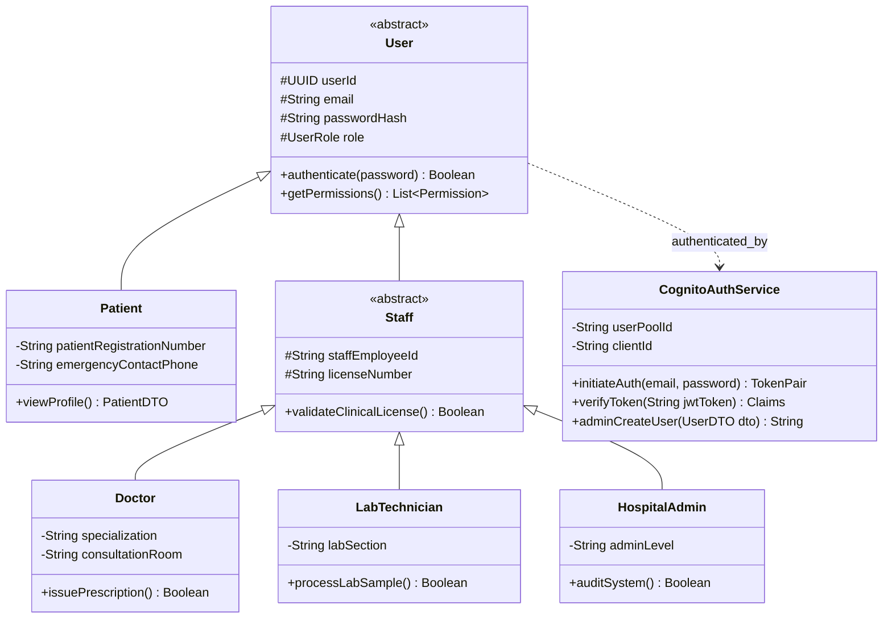
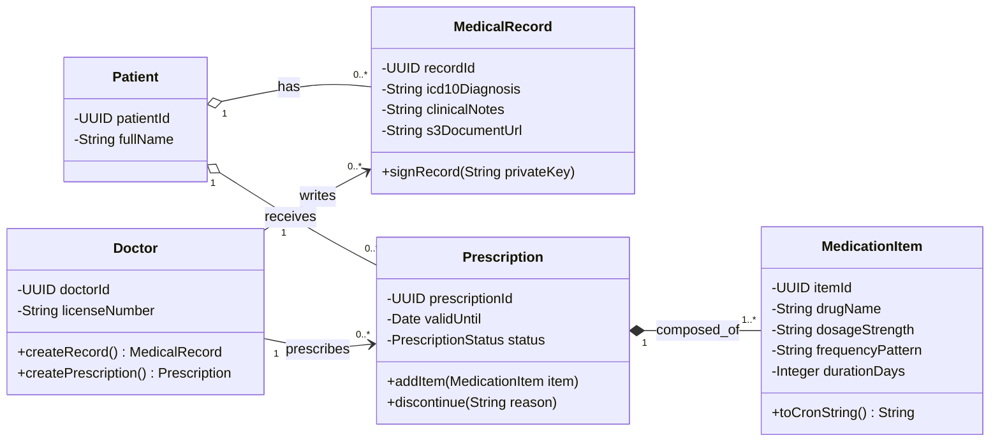
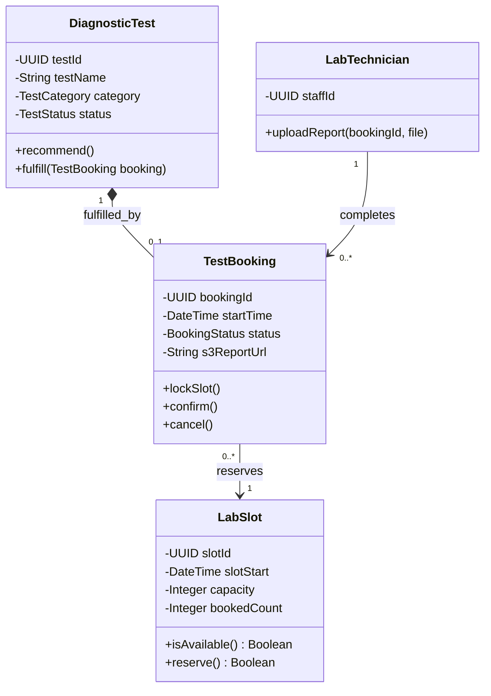
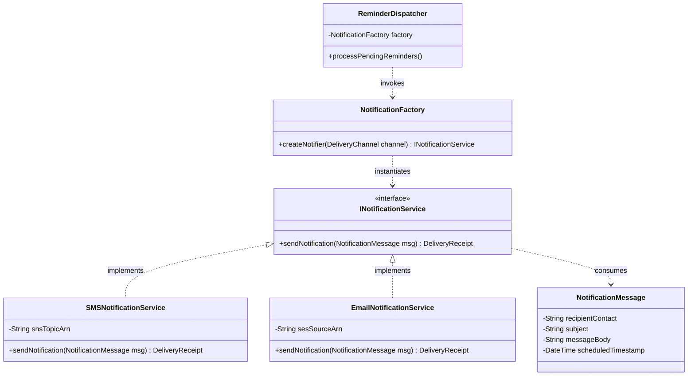

# EXPERIMENT 6

**Course Title**: Software Design Principles (SDP)  
**Course Code / Section**: IT-B (Academic Year 2026-27)  
**Selected Project**: Smart Hospital Management System (SHMS)  
**Document**: UML Class Diagram Design & Object-Oriented System Modeling  
**Tools Employed**: StarUML / Draw.io / Mermaid Class Modeling Engine  
**Deliverable**: Comprehensive UML Class Diagrams, CRC Cards, and Class Data Dictionary  
**Industry Mapping**: Object-Oriented System Design, Domain-Driven Design (DDD) & Design Patterns  
**Team Details**: 4 Collaborators (Team Project)  
**Contributor**: Gungun Jain (Roll No: `202401100600082`, `gungunjn08@gmail.com`)  

---

## 1. Aim
To perform Object-Oriented Analysis (OOA), identify domain entities, attributes, methods, access visibilities, and inter-class relationships, apply fundamental Object-Oriented Design Principles (SOLID) and architectural patterns, and engineer comprehensive UML Class Diagrams for the **Smart Hospital Management System (SHMS)** using StarUML and Draw.io.

---

## 2. Objectives
1. **Object-Oriented Domain Analysis**: Conduct Grammatical (Noun-Verb) Analysis and construct Class-Responsibility-Collaborator (CRC) cards to identify essential classes, encapsulation boundaries, and collaborative behaviors.
2. **Class Structural Specification**: Explicitly define class attributes (with primitive and complex types, constraints, and visibility: public `+`, private `-`, protected `#`, package `~`) and operations/methods (with parameter types and return values).
3. **UML Relationship Modeling**: Accurately model and differentiate all core object-oriented relationships:
   - **Generalization / Inheritance (`<|--`)**: Base `User` hierarchy specialized into `Patient`, `Doctor`, `LabTechnician`, and `HospitalAdmin`.
   - **Association (`-->`)**: Structural relationships between independent entities with explicit multiplicity/cardinality (`1`, `0..1`, `1..*`, `*`).
   - **Aggregation (`o--`)**: Weak "whole-part" relationships where the lifecycle of the child object is independent of the parent (e.g., `Department` aggregates `Doctor`).
   - **Composition (`*--`)**: Strong "whole-part" relationships where the lifecycle of the part is strictly bound to the whole (e.g., `Prescription` is composed of `MedicationItem` instances; destroying a prescription destroys its line items).
   - **Realization / Interface Implementation (`<|..`)**: Contracts decoupling business services from third-party notification adapters (`INotificationService`).
   - **Dependency (`..>`)**: Transient usage relationships between controllers, services, and factories.
4. **Multi-Tiered Architectural Class Separation**: Organize classes into clean architectural layers:
   - **Domain Layer**: Core Business Entities, Value Objects, and Enumerations.
   - **Application / Service Layer**: Business Logic Coordinators, Controllers, and Domain Services.
   - **Data Access / Repository Layer**: Persistence Abstractions and Data Access Objects (DAOs).
   - **Infrastructure / Cloud Adapter Layer**: AWS SDK wrappers for Cognito, S3, RDS, EventBridge, and SNS/SES.
5. **Design Pattern Integration**: Implement proven Gang-of-Four (GoF) patterns:
   - **Factory Method Pattern**: For dynamic instantiation of multi-channel notification handlers.
   - **Strategy Pattern**: For interchangeable notification dispatch algorithms (SMS vs. Email).
   - **Repository Pattern**: For database encapsulation across AWS Lambda microservices.
6. **Class Data Dictionary**: Formulate an exhaustive data dictionary documenting every domain class, its attributes, and its operational methods.

---

## 3. Theoretical Framework & Object-Oriented Design Principles

### 3.1 Principles of Object-Oriented Design (SOLID)
Object-Oriented Analysis and Design (OOAD) models a software system as a collaborative collection of discrete objects, each encapsulating data (attributes) and behavior (methods). A robust design adheres to the **SOLID** principles:

```text
+----------------------------------------------------------------------------------------------------+
|                                      SOLID DESIGN PRINCIPLES                                       |
+-------------------+--------------------------------------------------------------------------------+
| Principle         | Application in Smart Hospital Management System                                |
+-------------------+--------------------------------------------------------------------------------+
| S - Single        | Each class has exactly one reason to change.                                   |
|   Responsibility  | e.g., MedicalRecord manages clinical entries; Prescription manages drugs;    |
|   Principle (SRP) | NotificationDispatcher handles message routing.                                |
+-------------------+--------------------------------------------------------------------------------+
| O - Open/Closed   | Software entities should be open for extension, but closed for modification.   |
|   Principle (OCP) | New notification channels (e.g., WhatsApp, WebPush) are added by implementing |
|                   | INotificationService without modifying existing dispatcher code.               |
+-------------------+--------------------------------------------------------------------------------+
| L - Liskov        | Derived classes must be completely substitutable for their base classes.      |
|   Substitution    | Doctor, LabTechnician, and HospitalAdmin inherit from User and seamlessly     |
|   Principle (LSP) | satisfy the base authentication and session verification contracts.            |
+-------------------+--------------------------------------------------------------------------------+
| I - Interface     | Clients should not be forced to depend on interfaces they do not use.          |
|   Segregation     | IPatientViewer provides read-only medical record access;                      |
|   Principle (ISP) | IClinicalEditor provides write and diagnostic authorization.                   |
+-------------------+--------------------------------------------------------------------------------+
| D - Dependency    | High-level business modules should depend on abstractions, not concretions.    |
|   Inversion       | BookingService depends on ISlotRepository, not directly on AWS PostgreSQL      |
|   Principle (DIP) | connection drivers.                                                            |
+-------------------+--------------------------------------------------------------------------------+
```

### 3.2 UML Class Diagram Notation Reference

```text
    +-----------------------------------------------+
    |                  ClassName                    |  <-- 1. Class Name (and optional stereotypes)
    +-----------------------------------------------+
    | - privateAttribute : DataType = DefaultValue  |
    | # protectedAttribute : DataType               |  <-- 2. Attributes Compartment
    | + publicAttribute : DataType                  |         (Visibility, Name, Type, Default)
    +-----------------------------------------------+
    | + publicMethod(param : Type) : ReturnType     |  <-- 3. Operations / Methods Compartment
    | - privateHelper() : void                      |         (Visibility, Name, Parameters, Return)
    +-----------------------------------------------+
```

**Visibility Specifiers**:
- `+` **Public**: Accessible by any class across any package.
- `-` **Private**: Accessible strictly within the declaring class.
- `#` **Protected**: Accessible within the declaring class and its derived subclasses.
- `~` **Package / Default**: Accessible by any class within the same namespace or package.

**Multiplicity Notation**:
- `1` : Exactly one instance.
- `0..1` : Zero or one instance (optional).
- `*` or `0..*` : Zero or many instances.
- `1..*` : One or many instances (at least one mandatory).
- `n..m` : Specified range (e.g., `1..4` lab slots).

---

## 4. Object-Oriented Analysis (OOA)

### 4.1 Grammatical (Noun-Verb) Analysis
Analyzing stakeholder requirements from Experiment 3 and the SRS (Experiment 4) isolates structural candidate classes (nouns) and dynamic operations (verbs).

| Extracted Noun | Candidate Role | Classification / Domain Entity | Extracted Associated Verbs (Operations) |
| :--- | :--- | :--- | :--- |
| **User** | Actor / Identity | Base Class: `User` | `authenticate()`, `changePassword()`, `verifyMFA()` |
| **Patient** | Actor / Role | Subclass: `Patient` (inherits `User`) | `viewHistory()`, `bookSlot()`, `cancelBooking()`, `setPreferences()` |
| **Doctor** | Actor / Role | Subclass: `Doctor` (inherits `User`) | `diagnose()`, `recommendTest()`, `createPrescription()` |
| **Lab Technician** | Actor / Role | Subclass: `LabTechnician` (inherits `User`) | `manageSlots()`, `performTest()`, `uploadReport()` |
| **Administrator** | Actor / Role | Subclass: `HospitalAdmin` (inherits `User`) | `onboardStaff()`, `deactivateUser()`, `auditAccessLogs()` |
| **Medical Record** | Clinical Entity | Entity: `MedicalRecord` | `addEncounterNote()`, `attachScan()`, `signRecord()` |
| **Prescription** | Medication Plan | Entity: `Prescription` | `addItem()`, `discontinue()`, `calculateDosage()` |
| **Medication Item** | Line Item Detail | Component: `MedicationItem` | `computeSchedule()`, `validateDuration()` |
| **Diagnostic Test** | Investigation Order | Entity: `DiagnosticTest` | `orderTest()`, `updateStatus()`, `verifyPreconditions()` |
| **Test Booking** | Appointment Slot | Entity: `TestBooking` | `reserveSlot()`, `reschedule()`, `completeEncounter()` |
| **Laboratory Slot** | Resource Capacity | Value Object: `LabSlot` | `lockSlot()`, `releaseSlot()`, `isAvailable()` |
| **Reminder** | Automated Schedule | Entity: `ReminderSchedule` | `scheduleEvent()`, `triggerDispatch()`, `retry()` |
| **Notification** | Message Payload | Interface: `INotificationMessage` | `formatMessage()`, `sendSMS()`, `sendEmail()` |
| **Audit Log** | Security Entry | Entity: `AuditLog` | `recordEvent()`, `exportAuditReport()`, `verifyHash()` |

---

### 4.2 Class-Responsibility-Collaborator (CRC) Cards

Below are CRC cards for the ten core domain abstractions modeling responsibilities and collaborative partnerships.

#### CRC-01: `User` (Abstract Base Class)
- **Class**: `User`
- **Superclass**: None (Root)
- **Subclasses**: `Patient`, `Doctor`, `LabTechnician`, `HospitalAdmin`
- **Responsibilities**:
  - Encapsulate universal identity attributes (ID, email, phone, status).
  - Store and validate hashed security credentials.
  - Track user session lifecycle and multi-factor status.
- **Collaborators**: `CognitoIdentityService`, `AuditLogger`

#### CRC-02: `Patient`
- **Class**: `Patient`
- **Superclass**: `User`
- **Responsibilities**:
  - Maintain demographic details, blood group, and emergency contacts.
  - Hold reference to personal medical record portfolio.
  - Maintain active diagnostic test bookings and reminder preferences.
- **Collaborators**: `MedicalRecord`, `DiagnosticTest`, `TestBooking`, `ReminderSchedule`

#### CRC-03: `Doctor`
- **Class**: `Doctor`
- **Superclass**: `User`
- **Responsibilities**:
  - Maintain medical registration number, specialization, and clinical department.
  - Author formal clinical notes, diagnoses, and medical summaries.
  - Prescribe laboratory diagnostic tests and medication schedules.
- **Collaborators**: `MedicalRecord`, `Prescription`, `DiagnosticTest`, `Patient`

#### CRC-04: `MedicalRecord`
- **Class**: `MedicalRecord`
- **Responsibilities**:
  - Record dated clinical encounters, ICD-10 diagnostic codes, and vitals.
  - Associate uploaded medical documents (PDF/DICOM) via encrypted S3 references.
  - Maintain tamper-evident digital signatures of attending physicians.
- **Collaborators**: `Patient`, `Doctor`, `S3StorageService`

#### CRC-05: `Prescription`
- **Class**: `Prescription`
- **Responsibilities**:
  - Act as aggregate root for multiple `MedicationItem` instances.
  - Enforce treatment date boundaries (start date, duration, completion).
  - Check for drug contraindications and trigger reminder configuration.
- **Collaborators**: `Doctor`, `Patient`, `MedicationItem`, `ReminderSchedule`

#### CRC-06: `MedicationItem` (Compositional Component)
- **Class**: `MedicationItem`
- **Responsibilities**:
  - Encapsulate pharmaceutical drug name, dosage strength, and form (tablet, syrup, injection).
  - Define frequency (Morning/Noon/Night), relation to meals, and instructions.
  - Calculate exact reminder cron schedules.
- **Collaborators**: `Prescription`, `ReminderSchedule`

#### CRC-07: `DiagnosticTest`
- **Class**: `DiagnosticTest`
- **Responsibilities**:
  - Maintain clinical test orders (test catalog code, category, clinical justification).
  - Track order lifecycle (`RECOMMENDED` $\rightarrow$ `BOOKED` $\rightarrow$ `IN_PROGRESS` $\rightarrow$ `COMPLETED`).
  - Anchor test results and laboratory attachments.
- **Collaborators**: `Doctor`, `Patient`, `TestBooking`, `LabTechnician`

#### CRC-08: `TestBooking`
- **Class**: `TestBooking`
- **Responsibilities**:
  - Represent appointment reservations linking a patient, a test order, and a lab room.
  - Prevent double-booking through atomic slot reservation.
  - Manage rescheduling constraints and cancellation policies.
  - Hold uploaded lab diagnostic result URLs.
- **Collaborators**: `Patient`, `DiagnosticTest`, `LabSlot`, `LabTechnician`, `S3StorageService`

#### CRC-09: `ReminderSchedule`
- **Class**: `ReminderSchedule`
- **Responsibilities**:
  - Store scheduled execution timestamps for medicine doses and appointments.
  - Route alerts through preferred communication strategies (SMS, Email).
  - Track delivery acknowledgments, retries, and failures.
- **Collaborators**: `Patient`, `Prescription`, `EventBridgeScheduler`, `NotificationFactory`

#### CRC-10: `AuditLog`
- **Class**: `AuditLog`
- **Responsibilities**:
  - Capture immutable forensic entries for every sensitive healthcare transaction.
  - Record actor ID, target entity, action type, IP address, and SHA-256 integrity hash.
- **Collaborators**: `User`, `HospitalAdmin`, `CloudWatchLogger`

---

## 5. Comprehensive UML Class Diagrams

### 5.1 System-Wide Domain Model Class Diagram
The following UML class diagram provides the complete structural blueprint of the Smart Hospital Management System, capturing all classes, visibility modifiers, data types, method signatures, inheritance hierarchies, compositions, aggregations, and associations with multiplicities.

```mermaid
classDiagram
    %% Inheritance Hierarchy (Generalization)
    User <|-- Patient
    User <|-- Staff
    Staff <|-- Doctor
    Staff <|-- LabTechnician
    Staff <|-- HospitalAdmin

    %% Composition Relationships (Strong whole-part, lifecycle bound)
    Prescription *-- "1..*" MedicationItem : contains
    DiagnosticTest *-- "0..1" TestBooking : fulfills

    %% Aggregation Relationships (Weak whole-part)
    Patient o-- "0..*" MedicalRecord : maintains
    Patient o-- "0..*" Prescription : receives
    Patient o-- "0..*" DiagnosticTest : ordered_for
    Patient o-- "0..*" ReminderSchedule : subscribes_to
    Department o-- "1..*" Staff : employs

    %% Direct Associations
    Doctor "1" --> "0..*" MedicalRecord : authors
    Doctor "1" --> "0..*" Prescription : prescribes
    Doctor "1" --> "0..*" DiagnosticTest : recommends
    LabTechnician "1" --> "0..*" TestBooking : conducts
    TestBooking o-- "1" LabSlot : occupies
    ReminderSchedule --> "1" INotificationService : dispatches_via
    INotificationService <|.. SMSNotificationService : realizes
    INotificationService <|.. EmailNotificationService : realizes

    %% Dependency Relationships
    ReminderDispatcher ..> NotificationFactory : uses
    NotificationFactory ..> INotificationService : creates

    %% ==========================================
    %% CLASS DEFINITIONS
    %% ==========================================

    class User {
        <<abstract>>
        #UUID userId
        #String email
        #String passwordHash
        #String phoneNumber
        #UserRole role
        #AccountStatus status
        #DateTime createdAt
        #DateTime lastLoginAt
        +authenticate(String password) Boolean
        +changePassword(String oldPass, String newPass) Boolean
        +updateProfile(UserProfileDTO dto) Boolean
        +enableMFA() Boolean
        +verifyTOTP(String code) Boolean
        +getRole() UserRole
    }

    class Patient {
        -String patientRegistrationNumber
        -String bloodGroup
        -Date dateOfBirth
        -Gender gender
        -String emergencyContactPhone
        -String preferredNotificationChannel
        +viewMedicalHistory() List~MedicalRecord~
        +getRecommendedTests() List~DiagnosticTest~
        +bookTestSlot(UUID testId, UUID slotId) TestBooking
        +cancelBooking(UUID bookingId) Boolean
        +rescheduleBooking(UUID bookingId, UUID newSlotId) Boolean
        +setReminderPreference(String channel) Boolean
    }

    class Staff {
        <<abstract>>
        #String staffEmployeeId
        #String departmentName
        #String licenseNumber
        #DateTime employmentDate
        +getDepartment() String
        +verifyLicenseStatus() Boolean
    }

    class Doctor {
        -String specialization
        -String consultationRoom
        -Integer yearsOfExperience
        +createMedicalRecord(UUID patientId, MedicalRecordDTO dto) MedicalRecord
        +prescribeMedication(UUID patientId, PrescriptionDTO dto) Prescription
        +recommendDiagnosticTest(UUID patientId, TestOrderDTO dto) DiagnosticTest
        +reviewPatientFile(UUID patientId) PatientHistoryDTO
    }

    class LabTechnician {
        -String labSection
        -List~String~ certifiedTestCategories
        +publishAvailableSlots(LabSlotBatchDTO batch) Integer
        +updateSlotStatus(UUID slotId, SlotStatus status) Boolean
        +uploadLabReport(UUID bookingId, File reportFile) String
        +completeDiagnosticTest(UUID bookingId, LabResultDTO results) Boolean
    }

    class HospitalAdmin {
        -String adminLevel
        +provisionStaffAccount(StaffOnboardingDTO dto) Staff
        +deactivateUserAccount(UUID targetUserId) Boolean
        +inspectAuditLogs(AuditFilterDTO filter) List~AuditLog~
        +generateComplianceReport(Date startDate, Date endDate) ReportFile
    }

    class Department {
        -UUID departmentId
        -String name
        -String buildingLocation
        -String contactExtension
        +addStaffMember(Staff member) Boolean
        +removeStaffMember(UUID staffId) Boolean
        +getStaffList() List~Staff~
    }

    class MedicalRecord {
        -UUID recordId
        -UUID patientId
        -UUID doctorId
        -String primaryDiagnosisCode
        -String diagnosisDescription
        -String clinicalProgressNotes
        -String vitalsJson
        -String s3AttachmentUrl
        -DateTime encounterDateTime
        -String digitalSignatureHash
        +getRecordSummary() String
        +verifyIntegrity() Boolean
        +attachDocument(String s3Url) Boolean
    }

    class Prescription {
        -UUID prescriptionId
        -UUID patientId
        -UUID doctorId
        -DateTime prescribedDate
        -Date validUntilDate
        -PrescriptionStatus status
        -String clinicalInstructions
        -String s3PdfDocumentUrl
        +addMedicationItem(MedicationItem item) Boolean
        +removeMedicationItem(UUID itemId) Boolean
        +discontinue(String reason) Boolean
        +generatePdf() String
        +getMedicationItems() List~MedicationItem~
    }

    class MedicationItem {
        -UUID itemId
        -UUID prescriptionId
        -String drugName
        -String dosageStrength
        -DosageForm form
        -String frequencyPattern
        -MealRelation relationToMeal
        -Integer durationDays
        -Integer quantityPrescribed
        +calculateTotalDoses() Integer
        +getDailyDoseCount() Integer
        +toCronSchedule() String
    }

    class DiagnosticTest {
        -UUID testId
        -UUID patientId
        -UUID doctorId
        -String testCode
        -String testName
        -TestCategory category
        -ClinicalPriority priority
        -TestStatus status
        -String clinicalJustification
        -DateTime recommendedAt
        +assignBooking(TestBooking booking) Boolean
        +markCompleted(String reportUrl) Boolean
        +isEligibleForBooking() Boolean
    }

    class TestBooking {
        -UUID bookingId
        -UUID testId
        -UUID patientId
        -UUID technicianId
        -DateTime scheduledStartTime
        -DateTime scheduledEndTime
        -String labRoomNumber
        -BookingStatus status
        -String s3LabReportUrl
        -DateTime completedAt
        +confirmReservation() Boolean
        +reschedule(DateTime newStart, DateTime newEnd) Boolean
        +cancel(String cancellationReason) Boolean
        +attachReportBlob(String s3Url) Boolean
    }

    class LabSlot {
        -UUID slotId
        -String labRoomNumber
        -DateTime slotStart
        -DateTime slotEnd
        -Integer capacity
        -Integer bookedCount
        -SlotStatus status
        +isAvailable() Boolean
        +incrementBooking() Boolean
        +decrementBooking() Boolean
        +lockSlot() Boolean
    }

    class ReminderSchedule {
        -UUID reminderId
        -UUID patientId
        -UUID referenceEntityId
        -ReminderType reminderType
        -DateTime scheduledTime
        -DeliveryChannel channel
        -DeliveryStatus deliveryStatus
        -Integer retryCount
        -String payloadSummary
        +triggerNotification() Boolean
        +markDelivered() Boolean
        +markFailed(String reason) Boolean
        +incrementRetry() Boolean
    }

    class INotificationService {
        <<interface>>
        +sendNotification(NotificationMessage message) DeliveryReceipt
        +getChannelType() DeliveryChannel
    }

    class SMSNotificationService {
        -String awsSnsTopicArn
        -String senderId
        +sendNotification(NotificationMessage message) DeliveryReceipt
        +getChannelType() DeliveryChannel
    }

    class EmailNotificationService {
        -String awsSesSourceEmail
        -String emailTemplateId
        +sendNotification(NotificationMessage message) DeliveryReceipt
        +getChannelType() DeliveryChannel
    }

    class NotificationFactory {
        +getNotificationService(DeliveryChannel channel) INotificationService
    }

    class ReminderDispatcher {
        -NotificationFactory factory
        -ReminderRepository repository
        +processDueReminders(DateTime currentTime) Integer
        +dispatchSingleReminder(UUID reminderId) Boolean
    }

    class AuditLog {
        -UUID logId
        -UUID actorUserId
        -String actionType
        -String resourceAffected
        -String clientIpAddress
        -DateTime timestamp
        -ExecutionResult status
        -String sha256Hash
        +verifyLogAuthenticity() Boolean
    }
```



---

### 5.2 Subsystem Architectural Class Diagrams

#### Subsystem Diagram 1: Identity & Role-Based Access Control (RBAC) Subsystem
Illustrates the polymorphic user hierarchy, Amazon Cognito token validation, and permission authorization scopes.



---

#### Subsystem Diagram 2: Clinical Encounters & Prescription Management Subsystem
Demonstrates the strict composition lifecycle between Prescriptions and Medication Items, as well as the aggregation of Medical Records under Patients.



---

#### Subsystem Diagram 3: Diagnostic Test Recommendation & Slot Booking Subsystem
Illustrates appointment locking, laboratory room slot allocation, and diagnostic report publishing.



---

#### Subsystem Diagram 4: Automated Reminder & Notification Subsystem (Factory & Strategy Patterns)
Depicts the decoupled notification dispatch architecture utilizing Gang-of-Four Factory Method and Strategy patterns.



---

## 6. Comprehensive Class Data Dictionary / Specification

The following specifications detail the internal properties, access modifiers, method signatures, parameter types, return values, and business constraints for all domain model classes.

---

### 6.1 Class: `User` (Abstract Base Entity)
- **Stereotype**: `<<abstract entity>>`
- **Package**: `com.shms.domain.identity`
- **Description**: Core identity abstraction representing all authenticated actors within the cloud platform. Maps to the Amazon Cognito User Pool identity.

| Attribute Name | Visibility | Data Type | Default | Description / Invariants |
| :--- | :--- | :--- | :--- | :--- |
| `userId` | `#` Protected | `UUID` | Auto-generated | Globally unique primary key (RFC 4122 v4). |
| `email` | `#` Protected | `String` | None | Unique, validated email address (RFC 5322). |
| `passwordHash` | `#` Protected | `String` | None | Irreversible PBKDF2/Argon2 cryptographic hash. |
| `phoneNumber` | `#` Protected | `String` | None | E.164 international formatted phone string. |
| `role` | `#` Protected | `UserRole` | `PATIENT` | Enumeration: `PATIENT`, `DOCTOR`, `LAB_TECH`, `ADMIN`. |
| `status` | `#` Protected | `AccountStatus` | `PENDING_VERIFY` | Enumeration: `ACTIVE`, `LOCKED`, `SUSPENDED`, `DEACTIVATED`. |
| `createdAt` | `#` Protected | `DateTime` | `UTC_NOW` | Account creation timestamp. |
| `lastLoginAt` | `#` Protected | `DateTime` | `null` | Timestamp of most recent successful session initialization. |

| Method Signature | Visibility | Return Type | Parameter List | Description & Constraints |
| :--- | :--- | :--- | :--- | :--- |
| `authenticate(password)` | `+` Public | `Boolean` | `String password` | Validates submitted password against cryptographic hash. |
| `changePassword(oldPass, newPass)` | `+` Public | `Boolean` | `String oldPass, String newPass` | Verifies old password and enforces 12-char complexity rules on new password. |
| `enableMFA()` | `+` Public | `Boolean` | None | Initializes TOTP secret key for multi-factor authentication. |
| `verifyTOTP(code)` | `+` Public | `Boolean` | `String code` | Validates a 6-digit time-based one-time password token. |
| `getRole()` | `+` Public | `UserRole` | None | Returns the authorized role claim for security token encoding. |

---

### 6.2 Class: `Patient`
- **Stereotype**: `<<entity>>`
- **Package**: `com.shms.domain.patient`
- **Base Class**: Inherits from `User`
- **Description**: Represents a healthcare recipient registered in the hospital system.

| Attribute Name | Visibility | Data Type | Default | Description / Invariants |
| :--- | :--- | :--- | :--- | :--- |
| `patientRegistrationNumber` | `-` Private | `String` | Auto-generated | Hospital MRN (e.g., `SHMS-PAT-2026-00481`). |
| `bloodGroup` | `-` Private | `String` | None | Valid blood group (`A+`, `A-`, `B+`, `B-`, `O+`, `O-`, `AB+`, `AB-`). |
| `dateOfBirth` | `-` Private | `Date` | None | ISO 8601 calendar date; must be in the past. |
| `gender` | `-` Private | `Gender` | None | Enum: `MALE`, `FEMALE`, `OTHER`, `PREFER_NOT_TO_SAY`. |
| `emergencyContactPhone` | `-` Private | `String` | None | Emergency contact phone in E.164 format. |
| `preferredNotificationChannel`| `-` Private | `String` | `"BOTH"` | Preference: `"SMS"`, `"EMAIL"`, or `"BOTH"`. |

| Method Signature | Visibility | Return Type | Parameter List | Description & Constraints |
| :--- | :--- | :--- | :--- | :--- |
| `viewMedicalHistory()` | `+` Public | `List<MedicalRecord>` | None | Returns unredacted clinical records belonging to this patient. |
| `getRecommendedTests()` | `+` Public | `List<DiagnosticTest>` | None | Filters active tests where `status == RECOMMENDED`. |
| `bookTestSlot(testId, slotId)` | `+` Public | `TestBooking` | `UUID testId, UUID slotId` | Validates test recommendation and locks laboratory slot. |
| `cancelBooking(bookingId)` | `+` Public | `Boolean` | `UUID bookingId` | Releases slot if cancellation occurs $> 6$ hours before appointment. |
| `rescheduleBooking(bookingId, newSlotId)` | `+` Public | `Boolean` | `UUID bookingId, UUID newSlotId` | Replaces appointment reservation with new available slot. |
| `setReminderPreference(channel)` | `+` Public | `Boolean` | `String channel` | Updates alert preference setting. |

---

### 6.3 Class: `Doctor`
- **Stereotype**: `<<entity>>`
- **Package**: `com.shms.domain.clinical`
- **Base Class**: Inherits from `Staff` $\rightarrow$ `User`
- **Description**: Clinical physician licensed to document health encounters, recommend diagnostics, and prescribe medications.

| Attribute Name | Visibility | Data Type | Default | Description / Invariants |
| :--- | :--- | :--- | :--- | :--- |
| `specialization` | `-` Private | `String` | None | Clinical specialty (e.g., Cardiology, Neurology, General Medicine). |
| `consultationRoom` | `-` Private | `String` | None | OPD room or chamber number. |
| `yearsOfExperience` | `-` Private | `Integer` | `0` | Positive integer representing clinical tenure. |

| Method Signature | Visibility | Return Type | Parameter List | Description & Constraints |
| :--- | :--- | :--- | :--- | :--- |
| `createMedicalRecord(...)` | `+` Public | `MedicalRecord` | `UUID patientId, MedicalRecordDTO dto` | Commits clinical notes, diagnoses, and documents to patient file. |
| `prescribeMedication(...)` | `+` Public | `Prescription` | `UUID patientId, PrescriptionDTO dto` | Formulates prescription and triggers automated reminder hooks. |
| `recommendDiagnosticTest(...)` | `+` Public | `DiagnosticTest` | `UUID patientId, TestOrderDTO dto` | Issues laboratory investigation order. |
| `reviewPatientFile(...)` | `+` Public | `PatientHistoryDTO` | `UUID patientId` | Retrieves comprehensive longitudinal patient file. |

---

### 6.4 Class: `Prescription` & `MedicationItem` (Composite Pattern)
- **Stereotype**: `Prescription` (`<<aggregate root>>`), `MedicationItem` (`<<value object / part>>`)
- **Package**: `com.shms.domain.pharmacy`
- **Description**: Aggregate managing pharmacological therapy plans.

#### Attributes of `Prescription`:
- `- prescriptionId: UUID` : Primary key.
- `- patientId: UUID` : Foreign reference to patient.
- `- doctorId: UUID` : Foreign reference to prescribing doctor.
- `- prescribedDate: DateTime` : Creation timestamp.
- `- validUntilDate: Date` : Expiration threshold.
- `- status: PrescriptionStatus` : Enum (`ACTIVE`, `COMPLETED`, `DISCONTINUED`).
- `- clinicalInstructions: String` : General clinical advice (diet, rest).
- `- s3PdfDocumentUrl: String` : Pre-signed URL to signed PDF.

#### Methods of `Prescription`:
- `+ addMedicationItem(item: MedicationItem): Boolean` : Adds a medicine line item; enforces non-empty constraint.
- `+ removeMedicationItem(itemId: UUID): Boolean` : Deletes a line item before final signing.
- `+ discontinue(reason: String): Boolean` : Terminates prescription early and halts active reminders.
- `+ generatePdf(): String` : Compiles prescription data into an S3-persisted PDF.

#### Attributes of `MedicationItem`:
- `- itemId: UUID` : Unique item identifier.
- `- prescriptionId: UUID` : Parent prescription reference.
- `- drugName: String` : Commercial or generic pharmaceutical formulation.
- `- dosageStrength: String` : Concentration (e.g., `500 mg`, `10 ml`).
- `- form: DosageForm` : Enum (`TABLET`, `CAPSULE`, `SYRUP`, `INJECTION`, `OINTMENT`).
- `- frequencyPattern: String` : Daily frequency (e.g., `1-0-1`, `Once Daily`, `Every 8 Hours`).
- `- relationToMeal: MealRelation` : Enum (`BEFORE_MEAL`, `AFTER_MEAL`, `WITH_MEAL`, `EMPTY_STOMACH`).
- `- durationDays: Integer` : Total days of therapy ($1 \le d \le 90$).
- `- quantityPrescribed: Integer` : Total units dispensed.

#### Methods of `MedicationItem`:
- `+ calculateTotalDoses(): Integer` : Multiplies daily frequency by duration.
- `+ toCronSchedule(): String` : Translates frequency pattern into AWS EventBridge cron syntax.

---

### 6.5 Class: `DiagnosticTest` & `TestBooking`
- **Stereotype**: `<<entity>>`
- **Package**: `com.shms.domain.diagnostics`
- **Description**: Manages laboratory test recommendations, slot reservations, and result publishing.

#### Attributes of `DiagnosticTest`:
- `- testId: UUID` : Primary key.
- `- patientId: UUID` : Target patient reference.
- `- doctorId: UUID` : Recommending physician reference.
- `- testCode: String` : Standard catalog code (e.g., `LAB-CBC-001`, `RAD-MRI-004`).
- `- testName: String` : Descriptive test title (e.g., "Complete Blood Count").
- `- category: TestCategory` : Enum (`PATHOLOGY`, `RADIOLOGY`, `CARDIOLOGY`, `BIOCHEMISTRY`).
- `- priority: ClinicalPriority` : Enum (`ROUTINE`, `URGENT`, `STAT`).
- `- status: TestStatus` : Enum (`RECOMMENDED`, `BOOKED`, `IN_PROGRESS`, `COMPLETED`, `CANCELLED`).
- `- clinicalJustification: String` : Medical rationale documented by physician.
- `- recommendedAt: DateTime` : Creation timestamp.

#### Methods of `DiagnosticTest`:
- `+ assignBooking(booking: TestBooking): Boolean` : Links a confirmed appointment booking.
- `+ markCompleted(reportUrl: String): Boolean` : Updates status to `COMPLETED` and references S3 result.
- `+ isEligibleForBooking(): Boolean` : Returns true if status is `RECOMMENDED` and $< 30$ days old.

#### Attributes of `TestBooking`:
- `- bookingId: UUID` : Primary appointment reservation key.
- `- testId: UUID` : Foreign key to DiagnosticTest.
- `- patientId: UUID` : Foreign key to Patient.
- `- technicianId: UUID` : Assigned diagnostic lab technician.
- `- scheduledStartTime: DateTime` : Appointment start window.
- `- scheduledEndTime: DateTime` : Appointment end window (typically $+30$ min).
- `- labRoomNumber: String` : Room/bay identifier (e.g., `Lab Bay 3`, `MRI Suite A`).
- `- status: BookingStatus` : Enum (`CONFIRMED`, `CHECKED_IN`, `IN_PROGRESS`, `COMPLETED`, `CANCELLED`, `NO_SHOW`).
- `- s3LabReportUrl: String` : S3 bucket URL storing uploaded test findings.
- `- completedAt: DateTime` : Timestamp of test completion.

#### Methods of `TestBooking`:
- `+ confirmReservation(): Boolean` : Finalizes slot lock and triggers confirmation alerts.
- `+ reschedule(newStart: DateTime, newEnd: DateTime): Boolean` : Moves appointment to a new slot.
- `+ cancel(cancellationReason: String): Boolean` : Voids appointment and restores lab slot capacity.
- `+ attachReportBlob(s3Url: String): Boolean` : Attaches lab technician's uploaded PDF report.

---

### 6.6 Class: `ReminderSchedule` & Notification Subsystem
- **Stereotype**: `ReminderSchedule` (`<<entity>>`), `INotificationService` (`<<interface>>`)
- **Package**: `com.shms.domain.notifications`
- **Description**: Implements the Factory and Strategy patterns for automated patient alerting.

#### Attributes of `ReminderSchedule`:
- `- reminderId: UUID` : Primary key.
- `- patientId: UUID` : Recipient patient reference.
- `- referenceEntityId: UUID` : Associated `prescriptionId` or `bookingId`.
- `- reminderType: ReminderType` : Enum (`MEDICATION_DOSE`, `TEST_APPOINTMENT`, `FOLLOW_UP`).
- `- scheduledTime: DateTime` : Scheduled execution trigger time.
- `- channel: DeliveryChannel` : Enum (`SMS`, `EMAIL`, `MULTI_CHANNEL`).
- `- deliveryStatus: DeliveryStatus` : Enum (`PENDING`, `DISPATCHED`, `DELIVERED`, `FAILED`, `RETRYING`).
- `- retryCount: Integer` : Number of re-attempts ($0 \le r \le 3$).
- `- payloadSummary: String` : Sanitized, privacy-compliant alert text.

#### Methods of `ReminderSchedule`:
- `+ triggerNotification(): Boolean` : Evaluates status and dispatches alert via configured service.
- `+ markDelivered(): Boolean` : Sets status to `DELIVERED` and timestamps execution.
- `+ markFailed(reason: String): Boolean` : Records delivery failure code.
- `+ incrementRetry(): Boolean` : Increments retry counter; triggers DLQ fallback if $> 3$.

---

## 7. Object-Oriented Design Patterns Applied

```text
+---------------------+-------------------------------+----------------------------------------------------+
| Design Pattern      | Involved Classes              | Architectural Justification                        |
+---------------------+-------------------------------+----------------------------------------------------+
| Factory Method      | NotificationFactory           | Encapsulates channel instantiation logic. Enables  |
| (GoF Creational)    | INotificationService          | adding future channels (Push, WhatsApp) without    |
|                     | SMSNotificationService        | changing the core ReminderDispatcher.              |
|                     | EmailNotificationService      |                                                    |
+---------------------+-------------------------------+----------------------------------------------------+
| Strategy Pattern    | INotificationService          | Provides interchangeable dispatch algorithms at    |
| (GoF Behavioral)    | SMSNotificationService        | runtime based on patient contact preference flags. |
|                     | EmailNotificationService      |                                                    |
+---------------------+-------------------------------+----------------------------------------------------+
| Composite Pattern   | Prescription (Aggregate Root) | Treats individual medication items and the entire  |
| (GoF Structural)    | MedicationItem (Leaf Element) | prescription schedule uniformly during lifecycle   |
|                     |                               | changes (discontinuation cascades to all items).   |
+---------------------+-------------------------------+----------------------------------------------------+
| Repository Pattern  | PatientRepository             | Mediates between domain entity objects and data    |
| (Enterprise)        | BookingRepository             | mapping layers (PostgreSQL / AWS DynamoDB),        |
|                     | PrescriptionRepository        | shielding business logic from SQL/ORM bindings.    |
+---------------------+-------------------------------+----------------------------------------------------+
```

---

## 8. StarUML & Draw.io Implementation Guidelines

### 8.1 StarUML Modeling Procedure
1. **Initialize Model**: Launch StarUML $\rightarrow$ Select `Model` $\rightarrow$ `Add Diagram` $\rightarrow$ `Class Diagram`.
2. **Add Packages**: Create three root packages: `domain`, `service`, and `infrastructure` to mirror multi-tier boundaries.
3. **Class Construction**:
   - Drag `Class` element onto the diagram.
   - Double-click the top compartment to set the class name and stereotype (e.g., `<<abstract>> User`).
   - Right-click class $\rightarrow$ `Add` $\rightarrow$ `Attribute`: enter attribute name, visibility, and data type (e.g., `- email: String`).
   - Right-click class $\rightarrow$ `Add` $\rightarrow$ `Operation`: enter method signature (e.g., `+ authenticate(password: String): Boolean`).
4. **Establish Relationships**:
   - **Generalization**: Select `Generalization` tool; click `Doctor` and drag to `Staff`; click `Staff` and drag to `User`.
   - **Composition**: Select `Composition` tool (solid diamond); click `Prescription` and drag to `MedicationItem`. Set child multiplicity to `1..*`.
   - **Aggregation**: Select `Aggregation` tool (hollow diamond); click `Patient` and drag to `MedicalRecord`. Set child multiplicity to `0..*`.
   - **Interface Realization**: Select `Interface Realization` tool (dashed arrow with hollow triangle); drag from `SMSNotificationService` to `INotificationService`.
5. **Layout & Export**: Apply orthogonal line routing (`Format` $\rightarrow$ `Line Style` $\rightarrow$ `Rectilinear`) $\rightarrow$ Export to PNG / SVG.

### 8.2 Draw.io Modeling Procedure
1. **Configure Canvas**: Open [draw.io](https://app.diagrams.net) $\rightarrow$ Enable `UML` shape library in left sidebar.
2. **Use Standard Class Containers**: Drag `Class 2` or `Class 3` shapes (which provide distinct Name, Attribute, and Method compartments).
3. **Color-Code Architectural Layers**:
   - Domain Entities: Pastel Blue (`#e0f2fe`, stroke: `#0284c7`).
   - Abstract Classes & Interfaces: Pastel Purple (`#f3e8ff`, stroke: `#7e22ce`).
   - Services & Factories: Pastel Green (`#dcfce7`, stroke: `#16a34a`).
4. **Connector Styling**:
   - Generalization: Solid line, hollow closed arrowhead (`endArrow=block;endFill=0`).
   - Composition: Solid line, filled black diamond at whole (`startArrow=diamond;startFill=1`).
   - Aggregation: Solid line, hollow diamond at whole (`startArrow=diamond;startFill=0`).
   - Realization: Dashed line, hollow closed arrowhead (`dashed=1;endArrow=block;endFill=0`).
5. **Save Artifact**: Save drawing as `SHMS_Class_Diagram.drawio` in the `Docs/` directory.

---

## 9. Observations & Analytical Insights
1. **Encapsulation Prevents Inconsistent States**: Defining sensitive attributes (`passwordHash`, `bloodGroup`, `licenseNumber`) as private or protected prevents unauthorized direct mutations, routing all changes through verified methods.
2. **Composition Guarantees Referential Integrity**: Modeling `Prescription` $\rightarrow$ `MedicationItem` as a strict composition (`*--`) guarantees that orphan dosage records are never left dangling in the database when a prescription is revoked.
3. **Decoupling via Interfaces Enables Cloud Portability**: Decoupling `ReminderDispatcher` through the `INotificationService` interface ensures that if hospital infrastructure migrates from AWS SNS/SES to Twilio or SendGrid, zero domain logic changes are required.
4. **High Cohesion and Low Coupling**: Every class encapsulates exactly one domain concept, satisfying the Single Responsibility Principle and keeping inter-module coupling minimal.

---

## 10. Result
The Object-Oriented Analysis and UML Class Diagram Design for the **Smart Hospital Management System** were successfully executed. The complete structural blueprint—encompassing CRC cards, class hierarchies, multi-tier architectural packages, design pattern integrations, and an exhaustive Class Data Dictionary—was drafted in full compliance with UML 2.5 standards for engineering modeling in StarUML and Draw.io.

---

## 11. Team Contribution Note
* **Course**: Software Design Principles (SDP)
* **Team**: 4 Members Collaborating via GitHub
* **Contributor**: Gungun Jain (Roll No: `202401100600082`, `gungunjn08@gmail.com`)
* **Scope Handled**: Session 6 / Experiment 6 — Complete Object-Oriented Analysis (OOA), Class Identification, Attribute & Method Structural Definitions, UML Class Relationship Modeling (Inheritance, Association, Aggregation, Composition, Realization), Design Patterns Application, and Class Data Dictionary for the Smart Hospital Management System.
