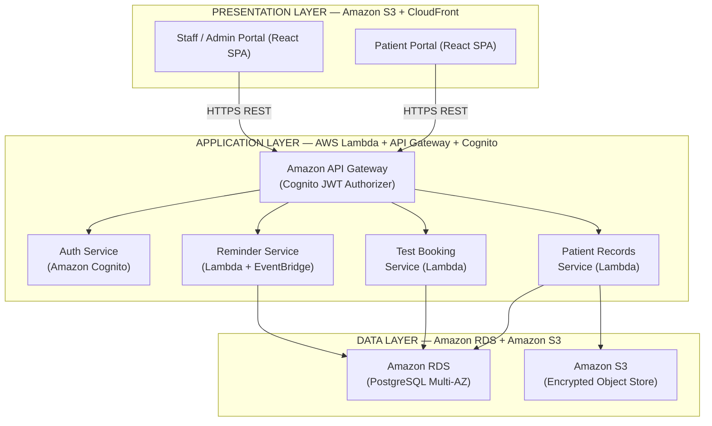
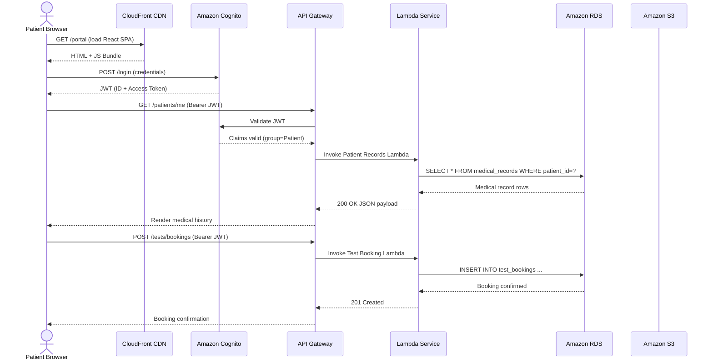

# EXPERIMENT 9

**Course Title**: Software Design Principles (SDP)  
**Course Code / Section**: IT-B (Academic Year 2026-27)  
**Selected Project**: Smart Hospital Management System (SHMS)  
**Document**: Software Architecture Design and Design Patterns  
**Tools Employed**: Draw.io / Mermaid Architecture Diagramming Engine  
**Deliverable**: System Architecture Diagrams (Layered, Client-Server, Microservices) and Design Patterns Catalogue  
**Industry Mapping**: Architectural Thinking, Structural Patterns, Cloud-Native System Design  
**Team Details**: 4 Collaborators (Team Project)  
**Contributor**: Rajan Verma (Roll No: `202401100600136`, `rajanverma192021@gmail.com`)  

---

## 1. Aim

To analyse, design, and document the software architecture of the **Smart Hospital Management System (SHMS)** from three complementary architectural perspectives — Layered (N-Tier) Architecture, Client-Server Architecture, and Microservices Architecture — and to identify and apply appropriate software design patterns that satisfy the system's quality attributes such as scalability, maintainability, security, and fault-tolerance.

---

## 2. Objectives

1. **Layered Architecture Design**: Decompose the SHMS into strict horizontal layers (Presentation, Application/Business Logic, Data) with well-defined inter-layer contracts, and document the responsibilities of each layer in the context of the AWS cloud deployment.
2. **Client-Server Architecture Design**: Model the network-level communication topology between two client portal types (Patient Portal, Staff/Admin Portal) and the centralised AWS backend, including authentication flows, API routing, and data transport mechanisms.
3. **Microservices Architecture (Conceptual)**: Identify bounded contexts and decompose the monolithic application logic into four independently deployable microservices — Auth, Patient Records, Test Booking, and Reminder — with explicit ownership of data stores and event-driven inter-service communication.
4. **Design Pattern Identification and Application**: Identify, describe, and apply six industry-standard Gang-of-Four (GoF) and architectural design patterns (MVC, Repository, Facade, Observer, Strategy, Singleton) with precise mapping to SHMS components.
5. **Architectural Quality Attribute Analysis**: Evaluate each architectural style against Non-Functional Requirements (NFRs) from the SRS (Experiment 4): availability, scalability, security, performance, and maintainability.
6. **Traceability to Prior Experiments**: Establish forward traceability from SRS functional requirements (Experiment 4) and Use Case subsystems (Experiment 5) to microservice boundaries.

---

## 3. Theoretical Framework and Background

### 3.1 What is Software Architecture?

Software Architecture is the high-level structural organisation of a software system, defining its components, their responsibilities, and the rules governing their interaction. It bridges the gap between requirements and implementation, making quality attribute trade-offs explicit.

A good software architecture:
- Exposes the **structure** of the system while hiding implementation details.
- Realises **all use cases and scenarios** identified during requirements analysis.
- Addresses the needs of **stakeholders** (developers, ops, compliance, patients, clinicians).
- Is **driven by quality attributes** such as performance, availability, security, and modifiability.

### 3.2 Architectural Styles Covered

```
+---------------------+--------------------------------------------------+-----------------------------+
|  Architecture Style |  Core Principle                                  |  Primary Viewpoint          |
+---------------------+--------------------------------------------------+-----------------------------+
|  Layered (N-Tier)   |  Separation of concerns via horizontal layers.   |  Internal logical structure |
|  Client-Server      |  Network topology: clients request, server        |  Deployment & network view  |
|                     |  responds.                                       |                             |
|  Microservices      |  Decompose by business capability into            |  Service boundary & data    |
|                     |  independently deployable services.               |  ownership view             |
+---------------------+--------------------------------------------------+-----------------------------+
```

### 3.3 Software Design Patterns

Design patterns are reusable solutions to commonly occurring design problems within a given context. They are classified into three categories by the Gang of Four (GoF):

| Category | Purpose | Examples Applied in SHMS |
| :--- | :--- | :--- |
| **Creational** | Object creation mechanisms | Factory Method (Notification handlers) |
| **Structural** | Composition of classes/objects | Facade (API Gateway surface), Repository (data access) |
| **Behavioural** | Communication between objects | Observer (EventBridge events), Strategy (SMS vs. Email), MVC (Frontend) |

### 3.4 Architectural Quality Attributes (ISO 25010)

```
+---------------------+--------------------------------------------------------------------+
| Quality Attribute   | Definition & SHMS Relevance                                        |
+---------------------+--------------------------------------------------------------------+
| Availability        | System must be accessible 99.9% of the time; use of managed AWS    |
|                     | services (Lambda, RDS Multi-AZ) ensures resilience.               |
| Scalability         | Lambda auto-scales per request; each microservice scales           |
|                     | independently based on load.                                       |
| Security            | Cognito JWT auth, API Gateway authorizer, IAM role-based access,   |
|                     | encryption at rest (RDS/S3) and in transit (HTTPS/TLS 1.3).       |
| Performance         | CloudFront CDN minimises latency; connection pooling in Lambda     |
|                     | reduces cold-start overhead.                                       |
| Maintainability     | Microservice isolation allows teams to update, redeploy, or        |
|                     | replace individual services without system-wide downtime.          |
+---------------------+--------------------------------------------------------------------+
```

---

## 4. Architecture 1 — Layered (N-Tier) Architecture

A **Layered Architecture** structures the system into a set of horizontal layers, each providing services to the layer above and consuming services from the layer below. No layer may skip a layer to communicate directly (strict layering enforced).

### 4.1 Three-Tier Layer Breakdown

```
+------------------------------------------------------------------+
|                     PRESENTATION LAYER                           |
|   +--------------------+        +--------------------------+     |
|   |   Patient Portal   |        |  Staff / Admin Portal    |     |
|   |  (React SPA)       |        |  (React SPA)             |     |
|   |  - My Records      |        |  - Patient Directory     |     |
|   |  - Book a Test     |        |  - Add / Update Records  |     |
|   |  - My Reminders    |        |  - Manage Bookings       |     |
|   |  - Download Rx     |        |  - Prescriptions         |     |
|   +--------------------+        +--------------------------+     |
|       Hosted: Amazon S3 + CloudFront CDN (Global Distribution)   |
+----------------------------+-------------------------------------+
                             | HTTPS REST / JSON API Calls
+----------------------------v-------------------------------------+
|                    APPLICATION LAYER                             |
|              (Business Logic and Orchestration)                  |
|                                                                  |
|  +-----------------+  +----------------+  +------------------+  |
|  | Patient Records |  | Test Booking   |  | Reminder Service |  |
|  | Service (Lambda)|  | Service        |  | (Lambda +        |  |
|  |                 |  | (Lambda)       |  |  EventBridge)    |  |
|  | - CRUD patient  |  | - Browse tests |  | - Schedule cron  |  |
|  |   profiles      |  | - Reserve slot |  | - Dispatch SMS   |  |
|  | - Add diagnoses |  | - Cancel/      |  | - Dispatch Email |  |
|  | - Attach docs   |  |   reschedule   |  | - Retry on fail  |  |
|  | - Role checks   |  | - Track status |  |                  |  |
|  +-----------------+  +----------------+  +------------------+  |
|                                                                  |
|         +----------------------------------------------+        |
|         |        Auth / Identity Service               |        |
|         |  (Amazon Cognito User Pools)                 |        |
|         |  - Register users   - Issue JWT tokens       |        |
|         |  - Verify MFA       - Group-based authZ      |        |
|         +----------------------------------------------+        |
|                                                                  |
|         Amazon API Gateway (Cognito Authorizer on all routes)    |
+----------------------------+-------------------------------------+
                             | SQL Queries / S3 SDK Calls
+----------------------------v-------------------------------------+
|                       DATA LAYER                                 |
|                                                                  |
|  +--------------------------------+  +------------------------+  |
|  |       Amazon RDS               |  |     Amazon S3          |  |
|  |   (PostgreSQL — Multi-AZ)      |  |   (Object Storage)     |  |
|  |                                |  |                        |  |
|  |  Tables:                       |  |  Buckets / Prefixes:   |  |
|  |  - users (patients, staff)     |  |  - /prescriptions/     |  |
|  |  - medical_records             |  |  - /reports/           |  |
|  |  - diagnoses                   |  |  - /scans/             |  |
|  |  - test_catalog                |  |  - /uploads/           |  |
|  |  - test_bookings               |  |                        |  |
|  |  - prescriptions               |  |  (Versioning + SSE-S3  |  |
|  |  - medication_items            |  |   encryption enabled)  |  |
|  |  - reminders                   |  |                        |  |
|  |  - audit_logs                  |  |                        |  |
|  +--------------------------------+  +------------------------+  |
+------------------------------------------------------------------+
```

### 4.2 Layer Responsibility Matrix

| Layer | AWS Technology | Primary Responsibility | Communication Protocol |
| :--- | :--- | :--- | :--- |
| **Presentation** | React SPA, Amazon S3, CloudFront | UI rendering, form input validation, role-based view rendering | Browser ↔ CloudFront: HTTPS |
| **Application** | AWS Lambda, API Gateway, Cognito | Business rule enforcement, auth, orchestration, role validation | API Gateway ↔ Lambda: internal AWS invocation |
| **Data** | Amazon RDS (PostgreSQL), Amazon S3 | Persistent relational storage, file/document object storage | Lambda ↔ RDS: TCP/SSL; Lambda ↔ S3: HTTPS |

### 4.3 Layered Architecture — Mermaid Diagram



### 4.4 Key Design Principles Applied

| Principle | Application in SHMS Layered Architecture |
| :--- | :--- |
| **Strict Layering** | Presentation Layer never queries RDS or S3 directly; all DB access is routed through Lambda services. |
| **Separation of Concerns** | Business rules (e.g., booking validation, role checks) live only in the Application Layer. |
| **Stateless Application Layer** | Lambda functions are stateless; horizontal scaling happens automatically without session state management. |
| **Centralised Auth** | Cognito is the sole authentication boundary — all routes on API Gateway require a valid JWT. |

---

## 5. Architecture 2 — Client-Server Architecture

The **Client-Server Architecture** models the system from a network topology perspective, describing how two distinct client types initiate requests and how the server cluster processes, authorises, and responds to them.

### 5.1 High-Level Client-Server Topology

```
CLIENT TIER                                   SERVER TIER (AWS Cloud)
-----------                                   -----------------------------------------------

+-------------------+                         +----------------------------------+
| Patient Browser / |  1. HTTPS Login Request  |        Amazon Cognito            |
| Mobile App        | -----------------------> |  (Hosted UI / OAuth2 Endpoint)   |
|                   | <----------------------- |  - Validates credentials         |
|                   |  2. JWT Token Issued      |  - Assigns group (Patient/Staff) |
+-------------------+                          |  - Returns ID + Access Token     |
                                               +----------------------------------+
+-------------------+                                       |
| Staff / Admin     |  3. HTTPS + Bearer JWT                | 4. Authoriser validates JWT
| Browser / App     | ------+--------------------------------v------------------+
|                   |       |                   Amazon API Gateway             |
|                   | <-----+                   (Cognito Authoriser on routes)  |
+-------------------+       |                   +---+------+-------------------+
         ^                  |                       |      |
         |                  |          Route: /patients/*  |  Route: /tests/*
         |                  |                 |            |  Route: /reminders/*
         |                  |                 v            v
         |   5. JSON         |     +------------------+  +------------------+
         |   Response        |     | Patient Records  |  | Test Booking     |
         +-------------------+     | Lambda           |  | Lambda           |
                                   +--------+---------+  +--------+---------+
                                            |                      |
                                            |     +-----------+    |
                                            |     | Reminder  |    |
                                            |     | Lambda    |    |
                                            |     +-----+-----+    |
                                            |           |          |
                                   +--------v-----------v----------v-------+
                                   |              DATA STORES               |
                                   |   +------------------+  +-----------+ |
                                   |   |   Amazon RDS     |  | Amazon S3 | |
                                   |   +------------------+  +-----------+ |
                                   +----------------------------------------+
```

### 5.2 Request-Response Communication Flow

```
Step 01: User opens Patient Portal or Staff Portal (served from CloudFront CDN).
Step 02: Unauthenticated user is redirected to Amazon Cognito Hosted UI.
Step 03: Cognito authenticates credentials, assigns group (Patient / Staff / Admin),
         and returns a signed JWT (ID Token + Access Token, RS256 algorithm).
Step 04: Client securely stores JWT in memory (not localStorage) and appends it to
         every subsequent API request:
            Authorization: Bearer <JWT Access Token>
Step 05: Request arrives at Amazon API Gateway.
Step 06: Cognito Authoriser validates the JWT signature and expiry.
         -> Invalid / expired -> 401 Unauthorized (returned to client).
         -> Valid -> API Gateway extracts claims and routes to Lambda.
Step 07: Lambda function reads Cognito group claim from event context.
         -> Enforces resource-level access control:
            e.g., Patient group cannot read another patient's records.
Step 08: Lambda executes business logic, queries Amazon RDS or Amazon S3.
Step 09: Lambda returns JSON payload to API Gateway.
Step 10: API Gateway returns the HTTP response (200 OK / 4xx / 5xx) to client.
Step 11: Client React component receives JSON and re-renders the UI.
Step 12: For reminder delivery: EventBridge Scheduler fires a cron rule ->
         invokes Reminder Lambda -> publishes to SNS (SMS) / SES (Email).
```

### 5.3 Role-Based Client Access Matrix

| Feature | Patient Client | Staff (Doctor/Tech) Client | Admin Client |
| :--- | :---: | :---: | :---: |
| View own medical record | Yes | Yes (all patients) | Yes |
| Create / update records | No | Yes | Yes |
| Upload medical documents | No (view only) | Yes | Yes |
| Browse recommended tests | Yes | No | Yes |
| Book a test slot | Yes | No | Yes |
| Manage lab slot availability | No | Yes (Lab Tech) | Yes |
| Generate prescription | No | Yes (Doctor) | Yes |
| Download prescription PDF | Yes | Yes | Yes |
| Receive automated reminders | Yes | No | No |
| Provision staff accounts | No | No | Yes |
| View system audit logs | No | No | Yes |

### 5.4 Notification Sub-System (Server-Initiated Communication)

```
Amazon EventBridge Scheduler
       |
       |  Cron Rule: e.g., "0 8 * * ? *" (daily 08:00 IST)
       v
Reminder Lambda Function
       |
       +-------> Amazon SNS -------> Patient Mobile Phone (SMS)
       |
       +-------> Amazon SES -------> Patient Email Inbox
```

### 5.5 Client-Server Mermaid Sequence Diagram



---

## 6. Architecture 3 — Microservices Architecture (Conceptual)

In the **Microservices Architecture**, the monolithic application layer is decomposed into a set of small, independently deployable services. Each service is bounded by a specific business capability, owns its own data store, and communicates with other services via asynchronous events or synchronous REST calls.

### 6.1 Bounded Context and Service Decomposition

Bounded contexts are derived from the Use Case subsystems identified in Experiment 5:

| Experiment 5 Subsystem | Microservice | Bounded Context |
| :--- | :--- | :--- |
| Identity & Access (UC-01 to UC-04) | **Auth Service** | User identity, credentials, roles |
| EHR & Clinical History (UC-05 to UC-08) | **Patient Records Service** | Medical records, documents, diagnoses |
| Diagnostic Test Management (UC-09 to UC-14) | **Test Booking Service** | Test catalogue, slot reservations, reports |
| Automated Reminders (UC-18 to UC-20) | **Reminder Service** | Reminder scheduling, notification dispatch |

### 6.2 Microservices Architecture Diagram

```
                    +------------------------------------+
                    |          API GATEWAY               |
                    |  (Single Entry Point for Clients)  |
                    |  Cognito Authoriser on all routes  |
                    +----+----------+----------+---------+
                         |          |          |
         +---------------+    +-----+----+    +----------+
         |                    |          |               |
         v                    v          v               v
+-------------------+  +----------+  +------------+  +----------+
|   Auth Service    |  | Patient  |  |   Test     |  | Reminder |
|                   |  | Records  |  |  Booking   |  | Service  |
| - Register user   |  | Service  |  |  Service   |  |          |
| - Login           |  |          |  |            |  | - Listen |
| - JWT issuance    |  | - CRUD   |  | - Browse   |  |   events |
| - Role assignment |  |   patient|  |   catalog  |  | - Sched- |
| - MFA verify      |  |   profile|  | - Reserve  |  |   ule    |
| - Token refresh   |  | - Add    |  |   slot     |  |   cron   |
|                   |  |   diagnosis  - Cancel     |  | - Send   |
| [Data Store]      |  | - Upload |  | - Track    |  |   SMS    |
| Cognito User Pool |  |   docs   |  |   status   |  | - Send   |
|                   |  | - View   |  | - Upload   |  |   Email  |
+-------------------+  |   history|  |   result   |  | - Retry  |
                       |          |  |            |  |   logic  |
                       | [Data]   |  | [Data]     |  |          |
                       | RDS:     |  | RDS:       |  | [Data]   |
                       | patients |  | test_cat   |  | RDS:     |
                       | records  |  | bookings   |  | remind.  |
                       | diagnoses|  | lab_slots  |  | prescrip.|
                       | S3:      |  |            |  |          |
                       | docs/    |  +------+-----+  +----+-----+
                       | scans/   |         |              |
                       +----+-----+         |              |
                            |               |              |
         Emits:             |      Emits:   |              |
         PatientCreated     |      BookingConfirmed        |
         PrescriptionAdded  |      TestCompleted           |
                            |               |              |
                    +-------v---------------v--------------v------+
                    |           Event Bus (Amazon EventBridge)    |
                    |   - Rule-based routing of domain events     |
                    |   - Decouples producers from consumers      |
                    +---------------------------------------------+
                                            |
                    +---------------------------------------------+
                    |          Reminder Service subscribes to:    |
                    |  - PatientCreated    -> init welcome notif  |
                    |  - PrescriptionAdded -> schedule med remind |
                    |  - BookingConfirmed  -> send booking notif  |
                    |  - TestCompleted     -> send result notif   |
                    +---------------------------------------------+
                                            |
                                   +--------v---------+
                                   | Amazon SNS / SES |
                                   | (Notification    |
                                   |  Dispatch)       |
                                   +--------+---------+
                                            |
                        +-------------------+------------------+
                        |                                      |
               Patient SMS (SNS)                   Patient Email (SES)
```

### 6.3 Microservice Specifications

#### Service 1: Auth Service

| Attribute | Detail |
| :--- | :--- |
| **Responsibility** | User registration, login, JWT token issuance, MFA verification, role/group assignment |
| **Technology** | Amazon Cognito User Pools, AWS Lambda (token validation helper) |
| **Owned Data Store** | Cognito User Pool (managed, no direct DB ownership) |
| **API Endpoints** | `POST /auth/register`, `POST /auth/login`, `POST /auth/refresh`, `POST /auth/mfa/verify` |
| **Events Produced** | `UserRegistered`, `UserDeactivated` |
| **Events Consumed** | None |
| **SRS Traceability** | REQ-1.1, REQ-1.2, REQ-1.3, REQ-1.4 |

#### Service 2: Patient Records Service

| Attribute | Detail |
| :--- | :--- |
| **Responsibility** | CRUD on patient profiles, medical record authoring, clinical note management, document upload/download |
| **Technology** | AWS Lambda, Amazon RDS (PostgreSQL), Amazon S3 |
| **Owned Data Store** | RDS tables: `patients`, `medical_records`, `diagnoses`; S3 bucket: `shms-documents/` |
| **API Endpoints** | `GET /patients/{id}`, `POST /patients`, `PATCH /patients/{id}/records`, `POST /patients/{id}/documents` |
| **Events Produced** | `PatientCreated`, `PrescriptionAdded`, `DocumentUploaded` |
| **Events Consumed** | None |
| **SRS Traceability** | REQ-2.1, REQ-2.2, REQ-2.3, REQ-2.4 |

#### Service 3: Test Booking Service

| Attribute | Detail |
| :--- | :--- |
| **Responsibility** | Test catalogue browsing, slot reservation/cancellation, lab slot management, result upload |
| **Technology** | AWS Lambda, Amazon RDS (PostgreSQL) |
| **Owned Data Store** | RDS tables: `test_catalog`, `test_bookings`, `lab_slots` |
| **API Endpoints** | `GET /tests/catalog`, `POST /tests/bookings`, `PATCH /tests/bookings/{id}`, `DELETE /tests/bookings/{id}` |
| **Events Produced** | `BookingConfirmed`, `BookingCancelled`, `TestCompleted` |
| **Events Consumed** | None |
| **SRS Traceability** | REQ-3.1, REQ-3.2, REQ-3.3, REQ-3.4, REQ-3.5 |

#### Service 4: Reminder Service

| Attribute | Detail |
| :--- | :--- |
| **Responsibility** | Schedule reminder cron jobs, subscribe to domain events, dispatch multi-channel notifications (SMS/Email) |
| **Technology** | AWS Lambda, Amazon EventBridge Scheduler, Amazon SNS (SMS), Amazon SES (Email) |
| **Owned Data Store** | RDS tables: `reminders`, `prescriptions`, `medication_items` |
| **API Endpoints** | `POST /reminders` (manual trigger), `GET /reminders/{patient_id}`, `PATCH /reminders/{id}` |
| **Events Produced** | `ReminderSent`, `ReminderFailed` |
| **Events Consumed** | `PatientCreated`, `PrescriptionAdded`, `BookingConfirmed`, `TestCompleted` |
| **SRS Traceability** | REQ-4.1, REQ-4.2, REQ-5.1, REQ-5.2, REQ-5.3 |

### 6.4 Inter-Service Communication Patterns

```
Synchronous (REST over HTTPS):
------------------------------
Client App ---> API Gateway ---> Lambda (service-specific)
Use Cases: Real-time data queries, CRUD operations, user-triggered actions.
Latency:   < 500ms (P95 target, per SRS NFR-2).

Asynchronous (Event-Driven via Amazon EventBridge):
----------------------------------------------------
Patient Records Service ---[PrescriptionAdded]---> EventBridge ----> Reminder Service
Test Booking Service    ---[BookingConfirmed]-----> EventBridge ----> Reminder Service
Test Booking Service    ---[TestCompleted]---------> EventBridge ----> Reminder Service

Use Cases: Decoupled background jobs, non-time-critical notifications.
Guarantees: At-least-once delivery; Reminder Service is idempotent.
```

### 6.5 Benefits of Microservices for SHMS

| Benefit | Concrete Application in SHMS |
| :--- | :--- |
| **Independent Deployment** | Reminder Service notification logic can be updated (e.g., adding WhatsApp) without touching Patient Records Service. |
| **Fault Isolation** | If Test Booking Service experiences a DB connection timeout, Patient Records Service continues serving medical history pages unaffected. |
| **Independent Scalability** | During post-OPD peak booking hours, Test Booking Service Lambda scales to hundreds of concurrent invocations while Reminder Service stays at minimum capacity. |
| **Team Autonomy** | Each service has a clear owner; teams can use different Lambda runtimes (Node.js, Python) per service without cross-team conflicts. |
| **Technology Evolution** | The Reminder Service could migrate from SNS/SES to a third-party provider (Twilio/SendGrid) by swapping only the adapter layer within its own boundary. |

---

## 7. Design Patterns Applied

### 7.1 Pattern 1 — Model-View-Controller (MVC)

| Attribute | Detail |
| :--- | :--- |
| **Category** | Architectural / Behavioural |
| **Where Applied** | Patient Portal and Staff Portal (React SPA frontend) |
| **Problem** | Mixing UI rendering, data fetching, and business logic in a single component leads to untestable, tightly coupled code. |
| **Solution** | Separate each React feature into three roles: **Model** (API service hooks fetching data from Lambda endpoints), **View** (React JSX components rendering data), **Controller** (event handlers and state managers mediating between Model and View). |
| **SHMS Example** | `PatientRecordsModel` fetches `/patients/{id}` from API Gateway. `MedicalHistoryView` renders the returned records as a timeline. `BookingController` handles the user's "Book Test" button click, validates the form, and calls `TestBookingModel`. |

### 7.2 Pattern 2 — Repository Pattern

| Attribute | Detail |
| :--- | :--- |
| **Category** | Structural / Data Access |
| **Where Applied** | All AWS Lambda functions accessing Amazon RDS |
| **Problem** | Embedding SQL queries directly in Lambda handler functions couples business logic to the database, making unit testing and DB migration difficult. |
| **Solution** | Introduce a `Repository` interface that abstracts all data-access operations. Lambda handler depends on the interface, not on a concrete PostgreSQL driver. |
| **SHMS Example** | `IPatientRepository` defines `findById(id)`, `save(patient)`, `update(id, patch)`. `RDSPatientRepository` implements this using `pg` (PostgreSQL). In unit tests, `MockPatientRepository` is injected instead. |

```
PatientRecordsLambda
      |
      | depends on (interface)
      v
IPatientRepository
      ^
      | implements
      |
RDSPatientRepository  <--->  Amazon RDS (PostgreSQL)
```

### 7.3 Pattern 3 — Facade Pattern

| Attribute | Detail |
| :--- | :--- |
| **Category** | Structural |
| **Where Applied** | Amazon API Gateway as the unified API surface |
| **Problem** | Client applications (Patient Portal, Staff Portal) would otherwise need to know the invocation ARNs and endpoints of four separate Lambda functions, leading to tight coupling and complex client logic. |
| **Solution** | API Gateway acts as a **Facade** — a single, simplified, consistent HTTP interface (`https://api.shms.hospital/`) that routes requests internally to the appropriate Lambda service based on path and method. |
| **SHMS Example** | `GET https://api.shms.hospital/patients/me` → API Gateway → Patient Records Lambda. `POST https://api.shms.hospital/tests/bookings` → API Gateway → Test Booking Lambda. The client does not know which Lambda handles which route. |

### 7.4 Pattern 4 — Observer Pattern

| Attribute | Detail |
| :--- | :--- |
| **Category** | Behavioural |
| **Where Applied** | Amazon EventBridge as the event bus between microservices |
| **Problem** | Patient Records Service should not directly call Reminder Service when a prescription is added. Direct coupling would make both services interdependent and fragile. |
| **Solution** | Patient Records Service acts as the **Subject/Publisher**; it emits a `PrescriptionAdded` event to EventBridge without knowing who observes it. Reminder Service is the **Observer/Subscriber**; it registers a rule to receive this event and schedule reminders. |
| **SHMS Example** | On `POST /patients/{id}/prescriptions` → Patient Records Lambda emits `{"detail-type": "PrescriptionAdded", "source": "shms.records", "detail": {"patientId": "...", "prescriptionId": "..."}}` to EventBridge → Reminder Lambda is invoked with the event → Schedules a recurring cron reminder. |

### 7.5 Pattern 5 — Strategy Pattern

| Attribute | Detail |
| :--- | :--- |
| **Category** | Behavioural |
| **Where Applied** | Reminder Service — notification delivery channel selection |
| **Problem** | The Reminder Service must deliver notifications via SMS or Email based on the patient's preference. Hardcoding `if channel == "SMS" ... else if channel == "EMAIL"` in the Lambda handler violates the Open/Closed Principle and is hard to extend (e.g., adding WhatsApp). |
| **Solution** | Define an `INotificationStrategy` interface with a `send(message, recipient)` method. Implement `SMSStrategy` (wraps SNS) and `EmailStrategy` (wraps SES). The `ReminderDispatcher` holds a reference to the chosen strategy, set at runtime based on patient preferences. |
| **SHMS Example** | `patient.notificationPreference == "SMS"` → `dispatcher.setStrategy(new SMSStrategy(snsClient))`. `patient.notificationPreference == "EMAIL"` → `dispatcher.setStrategy(new EmailStrategy(sesClient))`. `dispatcher.dispatch(reminderPayload)` is called uniformly regardless of the underlying channel. |

### 7.6 Pattern 6 — Singleton Pattern

| Attribute | Detail |
| :--- | :--- |
| **Category** | Creational |
| **Where Applied** | Database connection pool in AWS Lambda |
| **Problem** | Creating a new PostgreSQL connection on every Lambda invocation adds 50–200ms of cold-start latency and can exhaust RDS connection limits under concurrent load. |
| **Solution** | Initialise the RDS connection pool **outside the Lambda handler function**, in the module-level scope. AWS Lambda reuses the execution context (warm start), so the pool is created only once per container lifecycle and reused across invocations. |
| **SHMS Example** | `const pool = new Pool({ connectionString: process.env.DB_URL, max: 5 });` declared at the module top. The handler exports `async function handler(event) { const client = await pool.connect(); ... }` — the pool is effectively a Singleton per Lambda container. |

### 7.7 Design Patterns Summary Table

| Pattern | Type | Applied Component | Quality Attribute Addressed |
| :--- | :--- | :--- | :--- |
| MVC | Architectural / Behavioural | React SPA (Patient & Staff Portals) | Maintainability, Testability |
| Repository | Structural | Lambda → RDS data access | Maintainability, Testability |
| Facade | Structural | Amazon API Gateway | Simplicity, Loose Coupling |
| Observer | Behavioural | Amazon EventBridge event bus | Loose Coupling, Extensibility |
| Strategy | Behavioural | Reminder notification dispatch | Extensibility, OCP Compliance |
| Singleton | Creational | Lambda RDS connection pool | Performance, Resource Efficiency |

---

## 8. Architectural Style Comparison

| Dimension | Layered Architecture | Client-Server Architecture | Microservices Architecture |
| :--- | :--- | :--- | :--- |
| **Primary Viewpoint** | Internal logical structure | Network topology | Service boundary and data ownership |
| **Main Concern** | Separation of concerns per horizontal layer | Client-server communication protocol | Business capability decomposition |
| **Coupling Level** | Medium — layer-to-layer contract | Medium — client depends on server API contract | Low — event-driven, services independent |
| **Scalability** | Per-layer scaling | Server-side scaling | Per-service, independent auto-scaling |
| **Fault Tolerance** | Limited — layer failure impacts all above | Server failure affects all clients | High — individual service failure isolated |
| **Deployment Unit** | All layers deployed together | Server redeployed independently | Each service deployed independently |
| **Complexity** | Low — easy to understand and explain | Medium | High — requires DevOps maturity |
| **Best Used For** | Architectural education, internal structure docs | Network and API design specifications | Production cloud-native system design |
| **SHMS Relevance** | Explains AWS tier responsibilities | Explains JWT auth flow and API routing | Explains team service ownership |

---

## 9. Traceability Matrix — SRS Requirements to Architecture

| SRS Requirement | Description | Architecture Layer | Microservice | Design Pattern |
| :--- | :--- | :--- | :--- | :--- |
| REQ-1.1 | Patient registration and account creation | Application Layer | Auth Service | — |
| REQ-1.2 | Secure login with JWT authentication | Application Layer | Auth Service | Facade (API GW) |
| REQ-1.3 | Role-based access control (Patient/Staff/Admin) | Application Layer | Auth Service | — |
| REQ-2.1 | Create and update patient medical records | Application Layer | Patient Records Service | Repository |
| REQ-2.3 | Patient views own medical history (read-only) | Presentation + Application | Patient Records Service | MVC |
| REQ-2.4 | Upload and retrieve documents from S3 | Data Layer | Patient Records Service | Repository |
| REQ-3.2 | Patient books a recommended diagnostic test slot | Application Layer | Test Booking Service | Facade |
| REQ-3.3 | Booking status tracking (pending/booked/completed) | Application Layer | Test Booking Service | Repository |
| REQ-4.1 | Doctor generates a digital prescription | Application Layer | Patient Records Service | Repository |
| REQ-5.1 | System schedules medicine reminders from prescriptions | Application Layer | Reminder Service | Observer |
| REQ-5.2 | Automated reminder delivery via SMS/Email | Application Layer | Reminder Service | Strategy |
| REQ-6.2 | System audit logging for all access events | Data Layer (RDS audit_logs) | Patient Records / Auth Service | Singleton (pool) |

---

## 10. Tool Usage — Draw.io Procedure

### 10.1 Layered Architecture Diagram (Draw.io)

1. **Setup**: Open [https://app.diagrams.net](https://app.diagrams.net) → New Diagram → Blank Canvas.
2. **Layer Containers**: Use a tall vertical `Rectangle` container for each layer; label them `PRESENTATION LAYER`, `APPLICATION LAYER`, `DATA LAYER`.
3. **Components**: Inside each container, place `Rounded Rectangle` shapes for each service (e.g., Patient Portal, Lambda functions, RDS).
4. **Arrows**: Use solid arrows with `endArrow=block` between layers. Label arrows with the protocol (e.g., "HTTPS REST", "SQL/TLS").
5. **Color Scheme**:
   - Presentation: Light blue (`#dbeafe`, stroke `#1d4ed8`).
   - Application: Light green (`#dcfce7`, stroke `#15803d`).
   - Data: Light orange (`#ffedd5`, stroke `#c2410c`).

### 10.2 Microservices Architecture Diagram (Draw.io)

1. **Service Boxes**: Each microservice is a `Class 3` UML shape with three compartments: Service Name, API Endpoints, Data Store.
2. **Event Bus**: Represent EventBridge as a wide horizontal `Cylinder` with `Event Bus (Amazon EventBridge)` label.
3. **Synchronous Arrows**: Solid line with filled arrowhead (REST calls to API Gateway).
4. **Asynchronous Arrows**: Dashed line with hollow arrowhead (event publications to EventBridge).
5. **Save**: Export as `SHMS_Microservices_Architecture.drawio` in the `Docs/` directory.

---

## 11. Observations and Analytical Insights

1. **Layered Architecture as a Pedagogical Foundation**: The layered model provides the clearest mental model for understanding how AWS services map to traditional software tiers. CloudFront/S3 = Presentation, Lambda/API Gateway/Cognito = Application, RDS/S3 = Data.
2. **Client-Server Architecture Reveals Security Boundaries**: Mapping the JWT authentication flow step-by-step exposes where security can break down — expired tokens, missing authoriser configuration, or insufficient IAM permissions — making it a valuable security audit tool.
3. **Microservices Enable Independent Evolution**: The event-driven design via EventBridge ensures that adding a new notification channel (e.g., WhatsApp via Twilio) requires only extending the Reminder Service's Strategy implementations without touching any other service.
4. **Design Patterns Collectively Enforce SOLID**: MVC enforces SRP in the frontend. Repository enforces DIP in data access. Facade enforces ISP at the API layer. Observer enforces OCP in event handling. Strategy enforces OCP in notification dispatch.
5. **Trade-off Awareness**: Microservices introduce distributed system complexity (eventual consistency, network failures, distributed tracing). For a team of four, the Layered Architecture may be the pragmatic starting point for implementation, with Microservices adopted incrementally as the system scales.

---

## 12. Result

The Software Architecture Design for the **Smart Hospital Management System (SHMS)** was successfully completed. Three architectural perspectives were documented with detailed diagrams, step-by-step communication flows, and role-based access matrices. Six design patterns (MVC, Repository, Facade, Observer, Strategy, Singleton) were identified, described, and precisely mapped to SHMS components. Traceability from SRS functional requirements through architecture layers to microservice boundaries and design patterns was established.

---

## 13. Team Contribution Note

- **Course**: Software Design Principles (SDP)
- **Team**: 4 Members Collaborating via GitHub
- **Contributor**: Rajan Verma (Roll No: `202401100600136`, `rajanverma192021@gmail.com`)
- **Scope Handled**: Session 9 / Experiment 9 — Complete Software Architecture Design covering Layered Architecture, Client-Server Architecture, Microservices Architecture (Conceptual), Design Patterns Catalogue (MVC, Repository, Facade, Observer, Strategy, Singleton), Architectural Quality Attribute Analysis, SRS Traceability Matrix, and Draw.io Tool Procedures for the Smart Hospital Management System.
